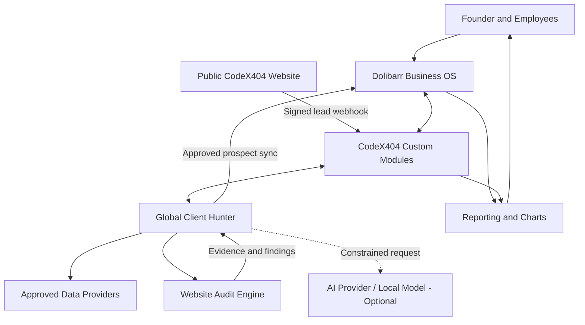
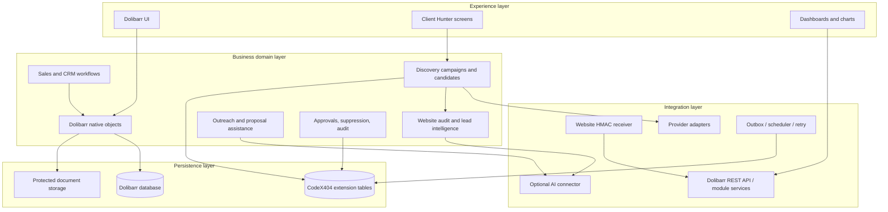
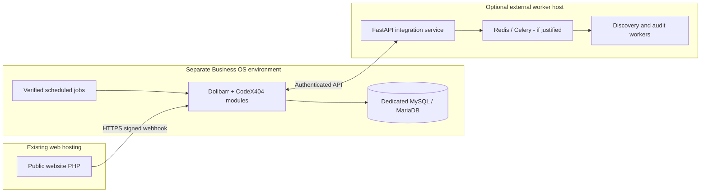
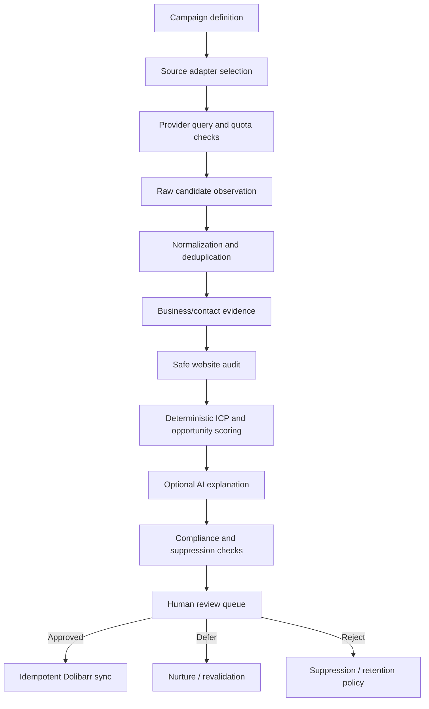
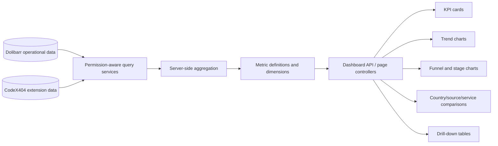

# CodeX404 Business OS — Architecture Specification

| Property | Decision / status |
|---|---|
| Architecture style | Dolibarr ERP core + CodeX404 extension modules + bounded integration services |
| System of record | Dolibarr for native ERP/CRM entities |
| Global lead acquisition | CodeX404 Client Hunter, initially internal and campaign-driven |
| Initial deployment | Separate Business OS application and database; Hostinger compatibility is unverified |
| Current website | Existing PHP application under `website/`; must remain isolated |
| Future compute | Separate Python/FastAPI worker service only when runtime and scale justify it |
| Status | Target architecture; Phase 0 audit required before implementation |
| Version | 2.0 |
| Last revised | 2026-11-21 |

---

## 1. Architecture objectives

1. Reuse a maintained ERP/CRM foundation instead of recreating financial and operational primitives.
2. Keep Dolibarr core upgradeable and unmodified.
3. Make CodeX404 functionality modular, permission-aware, testable, and removable without corrupting native data.
4. Support international lead research without polluting the ERP with every raw search result.
5. Keep the public website independent from Business OS deployment and database changes.
6. Separate slow, unreliable, or provider-limited discovery work from interactive ERP requests.
7. Define explicit data ownership, API contracts, audit points, failure handling, and deployment boundaries.
8. Provide management dashboards from validated business facts and governed aggregations.

## 2. Architecture decision records

### ADR-001 — Dolibarr as ERP/CRM foundation

**Decision:** Use Dolibarr as the candidate authoritative ERP/CRM platform, subject to selected-release compatibility, licensing, and native-module review.

**Rationale:** Dolibarr is a PHP ERP/CRM with modular functionality and documented extension mechanisms. It has REST APIs and developer mechanisms such as modules, hooks, and triggers. The current CodeX404 repository is PHP-first and the current hosting is described as Hostinger shared hosting; compatibility still has to be verified against the actual plan.

**Alternatives:**
- Build a bespoke PHP ERP/CRM: rejected because it duplicates complex accounting, invoicing, permission, and document workflows.
- Adopt a different ERP platform: remains an option if the current hosting or required business workflows are incompatible.
- Build a new CRM beside Dolibarr: rejected for native ERP/CRM entities because it creates data duplication and reconciliation risk.

**Trade-offs:** Native Dolibarr data model and UX shape the system. Some specialised pipeline, commission, approval, analytics, AI, and discovery capabilities may require CodeX404 extensions or a separate service.

### ADR-002 — Dolibarr is the system of record

**Decision:** Native company, contact, prospect/customer, commercial, financial, supplier, project, user, and permission records are owned by Dolibarr.

External services use supported Dolibarr APIs or reviewed module services. They must not write directly to Dolibarr tables.

### ADR-003 — Discovery candidates are staged before CRM sync

**Decision:** Global Client Hunter stores raw candidate observations and evidence in its discovery domain. Only candidates passing configured checks and human review are synchronized into Dolibarr.

**Reason:** A search result is not automatically a qualified prospect. Staging prevents duplicate companies, stale data, low-quality imports, and unnecessary personal-data retention.

### ADR-004 — Modular integration before microservices

**Decision:** Start with Dolibarr custom modules and bounded PHP integration logic. Separate the Client Hunter workers into Python/FastAPI only when runtime, concurrency, or library requirements justify an independent service and suitable hosting is available.

**Reason:** The architecture must fit real deployment constraints and avoid a distributed system before the organisation needs one.

### ADR-005 — Internal single-organisation first

**Decision:** The initial platform is for CodeX404 Solutions only. Public SaaS tenancy is out of scope until separately approved and security-reviewed.

### ADR-006 — Visual analytics is a governed product capability

**Decision:** Charts are generated from permission-filtered, server-side aggregates. Each chart has a metric definition, filter model, time basis, currency basis, refresh timestamp, and drill-down rule.

## 3. System context and boundaries



**Boundary rules:**
- Website content, public routes, website admin, and published portfolio remain owned by the existing website.
- Dolibarr owns operational records and access control for the ERP/CRM.
- CodeX404 custom modules own only CodeX404-specific records such as integration requests, campaign metadata, candidate evidence, score snapshots, commission approvals, or publication approval bridges when native functionality is insufficient.
- External AI providers do not become systems of record.
- GitHub is the source of truth for code and documentation.

## 4. Logical architecture



The diagram describes logical ownership, not a mandate for separate databases. Custom tables may live in the same Dolibarr database under the configured prefix if that is the approved module model. They must remain separate from and must not duplicate native Dolibarr business entities.

## 5. Deployment topology

### 5.1 Existing public website

- Canonical URL supplied by the owner: `https://codex404solutions.com/`.
- Existing source root: `website/`.
- Existing website has contact/discovery-call forms, an admin area, project/showcase handling, and a CRM webhook sender.
- Existing `.github/workflows/deploy.yml` is intended for website deployment.
- Business OS work must not change the website's production document root or deployment destination.

### 5.2 Proposed Business OS hosts

Proposed only; DNS and document roots are not verified:

- Development: `https://business-os-dev.codex404solutions.com/`
- Production: `https://business-os.codex404solutions.com/`

Use a separate application directory/document root and a separate database/user. Never install Dolibarr under the public website root or into `website/`.

### 5.3 Deployment variants

**Variant A — Shared-host deployment (conditional):** Dolibarr PHP application and database on Hostinger only if the selected release's PHP extensions, DB version, storage, SSL, cron, permissions, backup, and security requirements are met. CodeX404 background work must be bounded and scheduled; do not assume persistent workers.

**Variant B — Dedicated VPS/container deployment (future or required if shared host fails):** Dolibarr and custom modules on a maintained PHP runtime; optional Python/FastAPI service, PostgreSQL for service-owned data if justified, Redis/Celery for jobs, reverse proxy, and managed backups. Do not split services merely for fashion; introduce only where scaling or runtime constraints demand it.



No deployment variant is approved until the actual provider plan and environment are inspected.

## 6. Domain ownership and module boundaries

| Capability | System of record | Implementation boundary |
|---|---|---|
| Website pages, routes, public SEO, public assets | Existing website | Existing PHP application |
| Website public lead submission | Existing website until acknowledged | Existing local persistence + signed API request |
| User identity and ERP permissions | Dolibarr | Native account/rights model, verified in audit |
| Company, contacts, customers, suppliers | Dolibarr | Native third-party/contact objects |
| Sales proposal, order, invoice, payment | Dolibarr | Native modules and configuration |
| Projects, tasks, agenda | Dolibarr | Native modules; gaps recorded in module matrix |
| Discovery campaigns and raw candidate evidence | CodeX404 Client Hunter | Custom extension tables/service |
| Qualified CRM prospect after review | Dolibarr | Native records created through supported API/service |
| Website audit findings | CodeX404 Client Hunter | Evidence/finding records; not a duplicate website content database |
| Lead source and opportunity score snapshot | CodeX404 extension | Custom field or associated extension record; mapping decided after audit |
| Outreach draft and approval history | CodeX404 extension + Dolibarr activity | Draft artifact linked to native prospect/activity |
| Commission approval ledger | CodeX404 extension | Only if no acceptable native workflow exists |
| Public case-study content | Existing website | Approval/sync bridge only |
| Management aggregates | Read model/query layer | Permission-filtered aggregation, no duplicated mutable ERP facts |

## 7. Global Client Hunter architecture

### 7.1 Pipeline



### 7.2 Source adapter contract

Each provider adapter must implement a consistent internal contract:
- `provider_code` and connector version.
- Capability declaration: geography, categories, fields, pagination, query limits, rate limits, and known gaps.
- `search(campaign_query, cursor)` returning provider-native observations with source IDs and URLs.
- `normalize(raw_observation)` mapping only evidenced fields to the internal candidate schema.
- `health_check()` and a safe configuration status.
- Quota/rate-limit handling, retries with backoff, and provider-specific error mapping.
- Source terms and permitted-use reference reviewed before activation.

Prefer official APIs, licensed datasets, approved public directories, and user-authorised imports. The architecture must not bypass authentication, CAPTCHA, access controls, robots controls, provider quotas, or terms of service. A provider adapter stays disabled until its source and use are reviewed.

### 7.3 Candidate lifecycle

A candidate is a discovery observation. A prospect is an approved business relationship record in Dolibarr. Candidate states should include `discovered`, `normalized`, `needs_review`, `qualified`, `approved_for_sync`, `synced`, `deferred`, `rejected`, `suppressed`, `stale`, and `sync_failed`. State transitions are audited and idempotent.

### 7.4 International data model

Canonical stored values should include:
- Country: ISO 3166-1 alpha-2 where applicable.
- Currency: ISO 4217; retain source amount/currency and exchange-rate metadata for conversions.
- Time zone: IANA zone database identifier.
- Language: BCP 47 tag where available.
- Phone: normalized E.164 when a valid country context is known; retain source display value for traceability if needed.
- Address: structured fields plus original source text.

Never assume that campaign country equals contact time zone, language, legal jurisdiction, or currency. Each may differ and may be unknown.

### 7.5 Website audit isolation

The audit worker is an untrusted-network client. It must:
- Accept only a validated HTTP/HTTPS URL.
- Resolve DNS and block loopback, private, link-local, multicast, reserved, and cloud metadata ranges for IPv4 and IPv6.
- Re-check each redirect target and DNS resolution to mitigate DNS rebinding.
- Restrict ports, request size, response size, content types, redirect count, depth, and total execution time.
- Avoid executing downloaded scripts or active content.
- Use a dedicated outbound network policy where possible.
- Respect source access limitations and avoid authenticated or private resources.
- Record only the minimum necessary response facts and avoid retaining full pages by default.

## 8. Dolibarr extension design

Custom module source belongs under the repository's `business-os/custom/codex404/` boundary, but deployment packaging must follow the selected Dolibarr release's custom module layout.

A custom module may include:
- Module descriptor and compatibility/version metadata.
- Permission definitions and menus.
- Setup/configuration pages.
- Install, upgrade, and optional uninstall SQL scripts.
- Domain service classes and validation.
- Hooks and triggers for supported business events.
- API endpoints where justified and version-compatible.
- UI screens and dashboard widgets.
- Language files.
- Tests and operator documentation.

Use official module, hook, trigger, API, and permission extension mechanisms. Never patch Dolibarr core. Keep each module small and cohesive. A module must declare minimum/maximum tested versions and have an upgrade test before release.

### 8.1 Candidate custom modules

| Module | Responsibility | Gate |
|---|---|---|
| `modCx404LeadBridge` | Website intake, HMAC validation, idempotency, source attribution, retry visibility | P0 after API audit |
| `modCx404ClientHunter` | Campaign, candidate review, source metadata, sync workflow | P1 after source and data-policy review |
| `modCx404Intelligence` | Website findings, score snapshots, evidence links | P1 after crawler security review |
| `modCx404SalesAssistant` | Draft outreach/proposal assistance and approval history | P1/P2 after privacy review |
| `modCx404Commission` | Commission rule versions, approvals, ledger | Only if approved requirement exists |
| `modCx404PortfolioBridge` | Controlled export approval from internal projects to website showcase | When publishing workflow is needed |
| `modCx404Analytics` | Governed metrics, charts and drill-down UI | P0 basic; P1 advanced |
| `modCx404AIConnector` | Permission-aware tools for external AI service | P2 only |

Build only modules justified by the native-feature gap matrix.

## 9. API and integration contracts

### 9.1 Integration principles

- HTTPS only.
- Authenticated service identities with minimum rights.
- Explicit request schema and version.
- HMAC or token authentication based on the integration contract.
- Request timestamp and replay protection.
- Idempotency keys for create/update operations.
- Correlation/request ID for tracing.
- Structured response codes and safe error messages.
- Server-side validation and authorization.
- No direct SQL writes from external applications.
- No secret in browser code or public repository.

### 9.2 Website lead bridge

Preserve the existing sender contract until a staged migration is approved:
- `CRM_WEBHOOK_URL`
- `CRM_WEBHOOK_SECRET`
- `X-CodeX404-Signature`
- `X-CodeX404-Timestamp`
- `X-Idempotency-Key`

The receiving implementation must verify the exact raw request body, signature using a constant-time comparison, timestamp freshness, idempotency uniqueness, schema, and allowed values. The website's existing local persistence is a fallback and must remain intact until end-to-end tests prove the receiver is reliable.

### 9.3 API versioning

Use explicit versioned contracts, for example `/api/v1/...`, but only after verifying Dolibarr's API and custom-module routing conventions for the selected release. Avoid exposing internal PHP class names or database schemas as public contract.

### 9.4 Outbox and retry processing

Where an operation must be reliably delivered:
1. Persist the business action and outbox event in one transaction when possible.
2. Process a bounded batch in a scheduled worker.
3. Use a destination-specific idempotency key.
4. Record attempts and a safe error code.
5. Apply exponential backoff with a maximum retry policy.
6. Move persistent failures to a dead-letter/manual-review state.
7. Provide a controlled replay action requiring permission.

Do not retry non-idempotent external actions blindly.

## 10. Data ownership, consistency, and reporting

- Native Dolibarr records remain authoritative for business facts.
- Candidate data and raw source observations remain in the discovery domain until reviewed.
- Sync references are external identifiers, not copies of ERP records.
- A chart query must apply the same permissions as its record drill-down.
- Financial charts must separate currencies or convert using a documented rate source/date.
- Historical scores should retain the score algorithm version and evidence snapshot; do not overwrite history invisibly.
- Cached aggregates must have a refresh time, invalidation rule, and access-scope strategy.
- A report must not join unrestricted data across entity boundaries.

## 11. Dashboard and analytics architecture



A chart is a view over an approved metric. The server returns only the fields required to render it. The browser never receives unrestricted ERP records to calculate its own totals.

## 12. Repository and deployment architecture

Proposed structure:

```text
CodeX404_solutions/
├── website/                         # Existing public website; preserve
├── docs/
│   ├── Main-Website/
│   ├── CRM/
│   └── Business-OS/
├── business-os/
│   ├── custom/
│   │   └── codex404/                # CodeX404 Dolibarr modules only
│   ├── services/
│   │   └── client-hunter/           # Future independent service, if approved
│   ├── contracts/                   # JSON schemas / API contracts
│   ├── deployment/                 # manifests and safe packaging scripts
│   └── tests/
└── .github/workflows/
    ├── deploy.yml                   # Existing website workflow; preserve
    └── deploy-business-os.yml       # Separate, only after approval
```

Do not copy Dolibarr core into `business-os/custom/`. Keep its distribution and licensing decisions separate.

Branch and release rules:
- `dev` and feature branches are for development/integration.
- `main` is production and is never used for direct development.
- Deploy the public website and Business OS through separate workflows and destinations.
- Business OS deployment must target only its verified document root/custom module directory.
- Production deploy requires explicit owner approval, backup, acceptance tests, and rollback path.

## 13. Future architecture evolution

Introduce independent services only when there is a measurable reason:
- Python/FastAPI for discovery connectors or AI libraries that are awkward in PHP.
- Redis/Celery or another job system only when persistent workers and operational monitoring are available.
- PostgreSQL for service-owned research/analytics data only if the service genuinely needs it; Dolibarr's database is not replaced.
- n8n for approved workflow orchestration after credential, access, and failure semantics are reviewed.
- RAG over approved company documents with permission-aware retrieval.
- SaaS tenancy only after end-to-end tenant isolation and licensing review.

## 14. Architecture acceptance checklist

- [ ] Dolibarr release, PHP/database compatibility, license and hosting are verified.
- [ ] Native vs custom vs external ownership matrix is complete.
- [ ] Website and Business OS have separate deployment targets and databases.
- [ ] No code writes directly to Dolibarr tables outside supported module/application patterns.
- [ ] Custom extensions use documented Dolibarr extension mechanisms.
- [ ] Candidate staging is separate from CRM prospect creation.
- [ ] Source provenance, quotas, suppression and country policy are represented.
- [ ] Website audit has SSRF and resource-limit protections.
- [ ] Sync and retry operations are idempotent and observable.
- [ ] Dashboard queries are permission-filtered and currency-aware.
- [ ] Backup/restore and rollback are tested.
- [ ] No production change occurred without approval.


## 15. Official technical references

Verify these sources again when selecting or upgrading the Dolibarr release. Version-specific guidance takes precedence over generic examples.

- Dolibarr source repository and licence metadata: https://github.com/Dolibarr/dolibarr
- Dolibarr developer documentation: https://wiki.dolibarr.org/index.php/Developer_documentation
- Dolibarr module development: https://wiki.dolibarr.org/index.php/Module_development
- Dolibarr REST API, hooks and trigger overview: https://www.dolibarr.org/presentation-api.php

The Dolibarr GitHub repository currently identifies its project licence as GPL-3.0. The selected release's `COPYING` file, copyright notices, bundled dependencies, custom-module distribution model, and any hosted/modified distribution plans must be reviewed before release. This specification is not a legal opinion.
