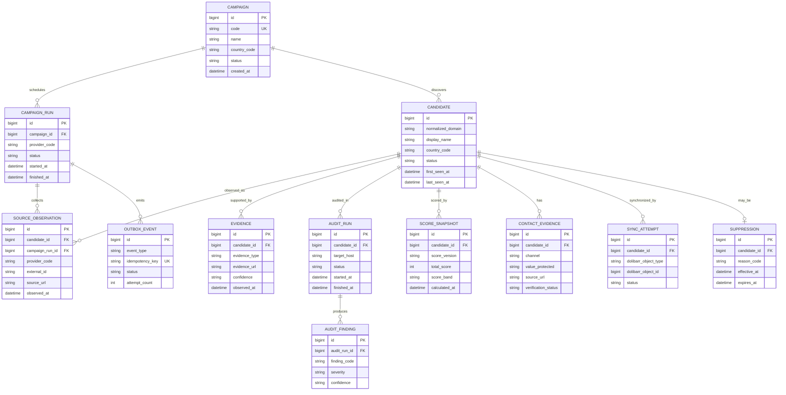

# CodeX404 Business OS — Database and Data Management Specification

| Property | Value |
|---|---|
| Database authority | Dolibarr database for native ERP/CRM entities |
| Extension data | CodeX404-prefixed custom tables, only where a verified gap exists |
| Candidate data | Short-lived discovery records until approved for Dolibarr sync |
| Initial organisation model | One CodeX404 organisation; entity/multi-company behaviour must be verified |
| Version | 2.0 |
| Status | Logical data design; physical SQL must follow the selected Dolibarr release and module conventions |

---

## 1. Database objectives

1. Preserve Dolibarr as the authoritative source for native business records.
2. Avoid duplicate company, contact, invoice, order, project, supplier, employee, or user tables.
3. Store only CodeX404-specific extension data where the native platform does not meet an approved requirement.
4. Keep Client Hunter candidate observations distinct from qualified Dolibarr prospects.
5. Preserve source provenance, score evidence, review decisions, and synchronization history.
6. Use explicit currency, country, language, and time-zone fields for international operations.
7. Protect personal data through minimization, purpose limitation, access controls, and retention rules.
8. Make schema changes versioned, repeatable, upgrade-safe, and reversible through tested restore/migration procedures.

## 2. Database ownership rules

- Dolibarr owns native ERP/CRM records and their lifecycle.
- CodeX404 extension tables own campaign definitions, discovery observations, evidence, scoring snapshots, integration receipts, outbox events, and other explicitly approved CodeX404-only data.
- External providers own their source records; CodeX404 stores provider identifiers and the minimum permitted observations.
- The public website owns its public content and existing local lead fallback until a confirmed synchronization is acknowledged.
- GitHub owns source code and schema scripts, never production data or secret values.

**Critical rule:** Do not create a second `companies`, `contacts`, `customers`, `invoices`, `payments`, `projects`, `users`, or `employees` table to reproduce Dolibarr. A discovery candidate is not a second customer master; it is a temporary, provenance-backed research record that may later link to one Dolibarr record.

## 3. Critical schema rules

1. Use Dolibarr's configured table prefix and extension conventions. Do not hard-code the default prefix.
2. Add a CodeX404-specific prefix to custom table names, following the selected release's module rules.
3. Add entity ownership fields where required by Dolibarr's entity model. Confirm actual multi-entity semantics before implementation.
4. Use stable primary keys and explicit indexes for real query paths.
5. Use `DECIMAL` for money; never use floating-point types for financial values.
6. Store ISO currency codes with amounts. Never combine unlike currencies without a recorded conversion basis.
7. Store timestamps consistently; use UTC internally where compatible and display in the user's IANA time zone.
8. Use `utf8mb4`-compatible encoding and a verified collation.
9. Use transactions and foreign references where supported by the chosen database engine and platform conventions.
10. Avoid SQL assumptions about Dolibarr's internal columns; use its supported object/API layer for native objects.
11. Never include secrets, API tokens, or full sensitive request payloads in business tables.
12. Every custom table must have an owner, purpose, retention period, access rule, migration path, and deletion policy.

## 4. Logical entity ownership

| Logical concept | Owner | Notes |
|---|---|---|
| User and login | Dolibarr | Native authentication source |
| Groups and permissions | Dolibarr + verified extension | Test multi-role and record-scope behaviour |
| Company / third party | Dolibarr | One canonical record per business relationship |
| Contact | Dolibarr | Do not create parallel contact master |
| Prospect/customer | Dolibarr | Approved records only |
| Proposal/order/invoice/payment | Dolibarr | Native commercial and financial records |
| Product/service | Dolibarr | BUILD/GROW/AUTOMATE catalogue |
| Project/task/agenda | Dolibarr | Native features; record capability gaps |
| Supplier/purchase | Dolibarr | Native procurement objects |
| Employee/HR | Dolibarr | Verify enabled modules; payroll is not assumed |
| Campaign definition | CodeX404 extension | One campaign per target profile and objective |
| Campaign run | CodeX404 extension | Execution, limits, status, and summary |
| Candidate observation | CodeX404 extension | Pre-CRM research record, limited retention |
| Source evidence | CodeX404 extension | Source URL/ID, collected time, confidence, permitted use |
| Website audit finding | CodeX404 extension | Evidence-backed technical observation |
| Score snapshot | CodeX404 extension | Versioned score and component explanation |
| Contact point evidence | CodeX404 extension | Public business contact provenance and validation state |
| Suppression/preference | CodeX404 extension or approved native mapping | Must be checked before outreach |
| Sync mapping | CodeX404 extension | Links candidate to existing/new Dolibarr object |
| Integration receipt/outbox | CodeX404 extension | Idempotency, retries, and audit |
| Commission rule/ledger | CodeX404 extension | Only if required and approved |
| Website publication approval | CodeX404 extension | Approval reference; public content remains website-owned |
| AI action audit | CodeX404 extension/service | Tool, permission, approval, target and outcome; no hidden reasoning trace |
| Dashboards | Read model/query service | Derived views, not a competing system of record |

## 5. Logical discovery data model

The following ER diagram is a logical model for CodeX404-owned discovery data. It deliberately does not model Dolibarr's physical tables. `dolibarr_object_type` and `dolibarr_object_id` are integration references, not foreign keys into undocumented internals.

### 5.1 Campaign

Suggested logical fields:
- `id`, `entity` where required, `code`, `name`, `description`, `owner_user_id`.
- `target_country_codes`, region/city filters, industry/category, keywords, language, business size band.
- `service_divisions`, service taxonomy references, selected ICP profile.
- `target_quantity`, `minimum_score`, `budget_limit`, provider quotas, schedule, timezone.
- `status`: draft, active, paused, completed, cancelled, archived.
- created/updated actor and timestamps.

Store complex targeting filters in a versioned JSON document only after validating the database's JSON support and enforcing an application schema. Do not let arbitrary JSON become an unvalidated query language.

### 5.2 Campaign run

Suggested fields:
- campaign reference, provider code/version, query fingerprint, cursor/page state.
- status, start/end time, result count, duplicate count, rejected count, error count.
- rate-limit and quota information, correlation ID, safe provider error code.
- operator/system actor and cost/usage counters where relevant.

### 5.3 Candidate

A candidate is a temporary discovery identity, not a customer record. Suggested fields:
- stable internal ID and optional entity value.
- normalized domain, display name, source-independent matching key.
- country/region/city/category when evidenced.
- website URL and validation status.
- candidate lifecycle status, first/last seen, stale-after time.
- linked Dolibarr object type/ID after successful sync.
- retention class and deletion/suppression state.

Avoid maintaining full address, phone, email, employee lists, or long-form company profiles indefinitely. Keep evidence in separate records with source and retention metadata.

### 5.4 Source observation and evidence

Store:
- provider code and provider record identifier.
- source URL or source reference.
- observed field names and minimal allowed values.
- collected timestamp and source timestamp if different.
- source terms/purpose review reference or provider policy version.
- confidence and validation state.
- payload hash for deduplication/integrity, not a full raw body unless necessary.

A data value without provenance should not be used as proof in an AI-generated opportunity report.

### 5.5 Website audit run and finding

Audit-run fields: candidate reference, normalized host, requested URL, status, audit version, start/end time, network policy version, and safe failure code.

Finding fields: finding code, category, severity, confidence, observation text, evidence URL/path, test method, first/last detected time, and whether the finding is a measured fact or inference.

### 5.6 Score snapshot

Store the deterministic scoring version, total and dimension scores, input evidence references, calculation time, reviewer override, override reason, and final displayed band. Never overwrite older score snapshots without an audit trail.

### 5.7 Contact evidence and suppression

For each contact point, store channel, normalized/protected value, public/private classification, source URL, observed time, verification status, confidence, country context, purpose, and lawful-use review status as applicable.

Suppression records must prevent an individual/business/channel from being selected for outreach according to the applicable scope. Do not delete an opt-out in a way that makes the system contact that person again. Retain only the minimum suppression identifier needed to honour the request, under a documented policy.

## 6. Integration and reliability tables

### 6.1 Website lead integration receipt

Potential logical table: `cx404_integration_receipts`.

Fields:
- `id`, `idempotency_key` (unique), source system, event type, request timestamp, received timestamp.
- processing status: received, processed, duplicate, rejected, retry_pending, dead_letter.
- target object type/ID, request/correlation ID, attempt count, next retry time.
- safe error code and timestamps.

Do not store the shared secret, signature, or full personal-data body. If payload retention is required for a retry, minimize and encrypt/protect it and define an expiry.

### 6.2 Outbox

Potential logical table: `cx404_outbox`.

Fields:
- event type, aggregate type/ID, schema version, destination.
- minimized payload or reference to a protected record.
- destination-specific idempotency key (unique), status, attempt count.
- available time, last attempt, delivered time, safe last error, correlation ID.

### 6.3 Synchronization mapping

Potential logical table: `cx404_external_mappings`.

Fields: source system, external identifier, Dolibarr object type/ID, first/last sync time, mapping status, source campaign, conflict state, and audit metadata. Add a unique constraint on the correct source/identifier/entity combination after mapping rules are approved.

### 6.4 Commission ledger — optional

Only if commission policy is approved and native modules are insufficient. Separate rule versions, entries, approvals, payout records, and reversals. Retain the eligible basis amount, currency, rule version, calculation, approval identity/time, payout reference, and adjustment linkage. Use decimal arithmetic and do not treat an unsigned/uncollected proposal as an earned commission unless policy explicitly says so.

### 6.5 Portfolio publication bridge — optional

Record internal project reference, website project reference/slug, client permission state, approved public fields/assets, reviewer, approval time, published time, revocation/expiry, and synchronization status. The website remains the owner of the public portfolio content.

### 6.6 AI tool audit — future

Record authenticated user, tool name, read/write classification, permission result, target object reference, approval reference, model/provider identifier (not secret), result status, correlation ID, and timestamp. Do not store hidden chain-of-thought or unrestricted copies of ERP data.

## 7. International data conventions

| Attribute | Canonical representation | Rule |
|---|---|---|
| Country | ISO 3166-1 alpha-2 where available | Do not infer from language alone |
| Currency | ISO 4217 | Original amount and currency remain authoritative |
| Time zone | IANA time-zone ID | Store/display with explicit zone semantics |
| Language | BCP 47 tag | Language may differ from country |
| Telephone | E.164 when valid | Preserve source formatting only when necessary for traceability |
| Address | Structured components + source text | Local address formats differ |
| Dates | Timestamp plus timezone context | Use user locale for display |
| Exchange rate | Rate, source, quote/base currency, observation time | Never use an unrecorded conversion in financial reporting |

## 8. Analytics and reporting data

Dashboards should initially query Dolibarr's supported object layer or controlled reporting queries. If performance requires pre-aggregation, use a read model with:
- metric name and definition version;
- aggregation grain (day/week/month, country, source, service, owner, stage);
- entity/access scope;
- currency basis;
- timezone/date boundary;
- refresh time and source watermark;
- invalidation/rebuild method.

Never use stale cached totals to make financial decisions without displaying their refresh timestamp. Drill-down must repeat record-level authorization. Exports must be audited.

## 9. Data classification and retention

| Class | Examples | Default handling |
|---|---|---|
| Public business data | Published business address, website, public service category | Store with source and collection date; review permitted use |
| Business contact data | Generic business mailbox, public phone, named work contact | Restrict access, minimize, source/retention/communication-purpose metadata |
| Confidential commercial | Proposals, price, contracts, customer notes | Role-limited, private documents, audit access where appropriate |
| Financial | Invoice, payment, bank, expense | Finance permissions, financial retention and backup controls |
| HR/personnel | Employee, applicant, salary/leave data | Strict HR scope; separate retention/legal review |
| Credentials/secrets | API keys, HMAC secrets, passwords | Never store in business tables or Git; use secure configuration |

Every stored field must have a purpose. Set explicit retention periods by data class and jurisdiction after legal review. Discovery observations should generally have shorter retention than a real customer relationship; do not keep unqualified candidate data forever.

## 10. Tenant and Dolibarr entity boundaries

Initial scope is one internal CodeX404 organisation. Verify Dolibarr's entity/multi-company model in the selected release. Do not assume a custom `tenant_id` makes the system multi-tenant.

Before any SaaS/tenant expansion:
1. Model tenant ownership for every native and custom entity.
2. Test access across entities for UI, API, search, reports, exports, files, and jobs.
3. Include entity in unique keys and relevant indexes where required.
4. Test cross-tenant ID substitution and background worker scope.
5. Review document storage isolation and backups.
6. Complete independent security and privacy review.

## 11. Data migration

Potential sources: website lead JSON fallback files, website project/showcase data, any authorised customer lists, and approved legacy CRM data if it exists.

Migration procedure:
1. Inventory source, format, sensitivity, owner, count, and retention status.
2. Confirm legal/operational authority to migrate.
3. Take protected backups.
4. Map fields to native Dolibarr objects or approved extension records.
5. Normalize domain/email/phone/country/currency/date values.
6. Identify duplicates and unresolved conflicts.
7. Run a dry-run in staging and produce a reconciliation report.
8. Verify permissions, totals, references, and sample records.
9. Obtain owner approval before production migration.
10. Retain source backups and migration logs according to the approved retention schedule.

Do not import `.env` files, credentials, Git internals, debug logs, or personal test data as business records.

## 12. Indexing and performance

Add indexes after observing query plans and expected volumes. Potential indexes include:
- unique idempotency key;
- provider code + external ID;
- normalized domain + country/entity scope;
- campaign + status + created date;
- candidate status + last seen;
- assigned user + follow-up date;
- source + campaign + qualification status;
- outbox status + next attempt;
- invoice status + due date;
- opportunity stage + expected close date;
- project status + manager.

Avoid indexing large text fields blindly. Use pagination, bounded campaign runs, and capped audit fetches on shared hosting.

## 13. Backup and recovery

- Back up database and private document storage together with coordinated timestamps where possible.
- Encrypt backups at rest and restrict access.
- Keep at least one backup copy outside the hosting account.
- Define RPO/RTO after the hosting capability is known.
- Test restore to an isolated environment.
- Verify extension code version and DB schema version after restore.
- Never commit production SQL dumps or customer exports to GitHub.
- Do not expose backup directories through public web access.
- Do not rely solely on the hosting provider's automatic backups.

## 14. Database acceptance checklist

- [ ] Native/custom data ownership matrix is approved.
- [ ] No duplicate core ERP/CRM entities exist.
- [ ] Candidate staging and retention are explicit.
- [ ] Source provenance and score evidence are retained.
- [ ] International canonical fields are defined.
- [ ] Money uses decimal precision and currency codes.
- [ ] Custom table prefix/entity conventions are verified.
- [ ] Install/upgrade scripts are versioned and tested.
- [ ] Unique/idempotency constraints prevent duplicate operations.
- [ ] Analytics read models respect permissions and currency/time boundaries.
- [ ] Privacy/retention/suppression rules are implemented.
- [ ] Backup and restore have been tested.
