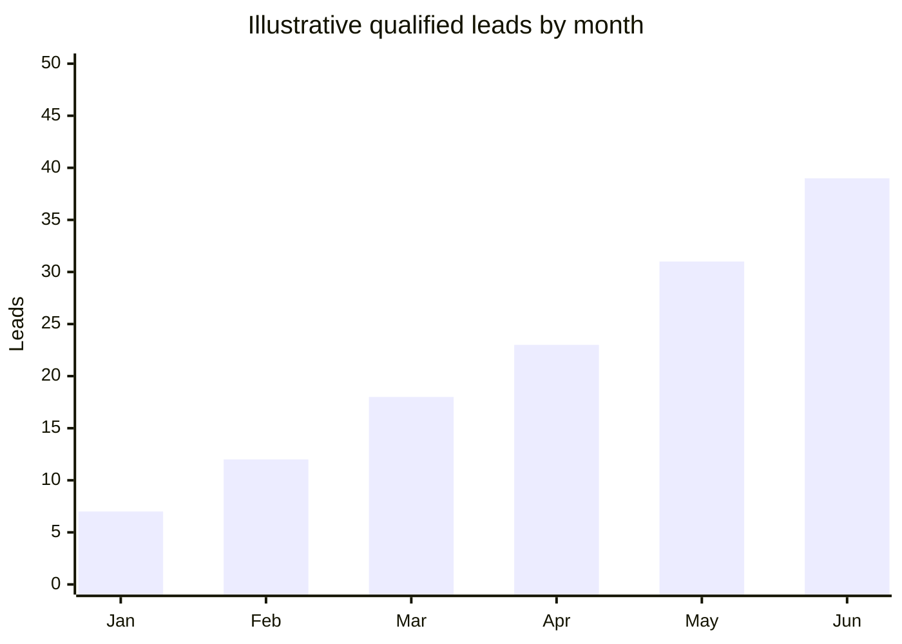
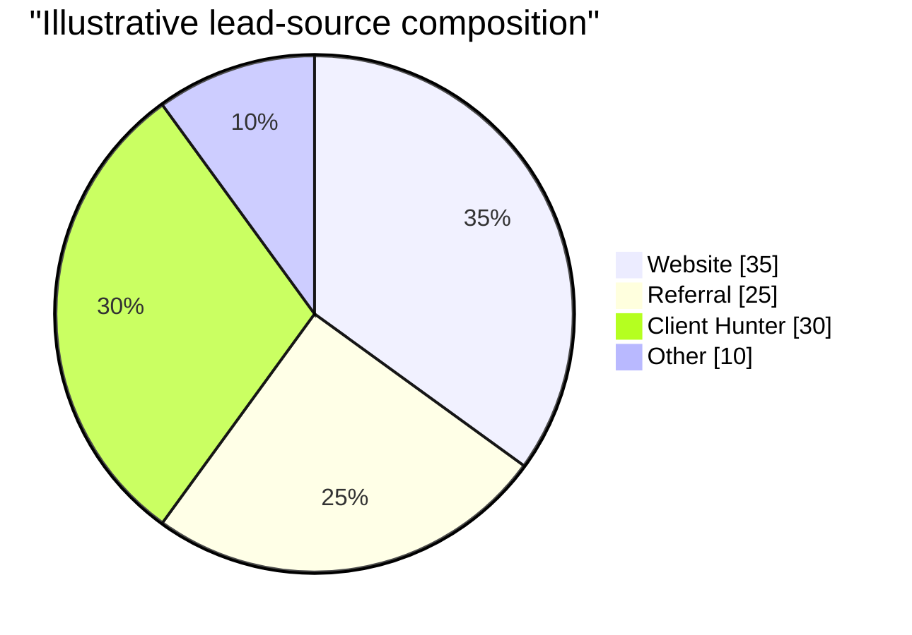
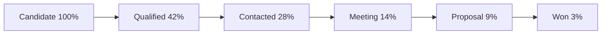

# CodeX404 Business OS — UI, Visualisation, and Experience Specification

| Property | Value |
|---|---|
| Product | CodeX404 Business OS |
| UI foundation | Dolibarr UI and supported custom-module extension points |
| Visual direction | Premium, calm, information-rich operations workspace |
| Brand | Preserve the existing CodeX404 identity and logo assets |
| Version | 2.0 |
| Status | Design system and interaction requirements; verify supported theme mechanisms in the chosen Dolibarr release |

---

## 1. Design objective

Business OS is an internal enterprise workspace, not a marketing landing page. It must help a person understand the current state of work, find the next action, and perform that action safely.

The experience should be:
- Clear: meaningful labels, consistent status, and obvious ownership.
- Dense but readable: operational information is easy to scan without decorative clutter.
- Consistent: lists, detail pages, forms, dialogs, charts, and notifications use shared patterns.
- Accessible: keyboard support, contrast, labels, non-colour cues, and text alternatives.
- Responsive: core tasks work on laptop, tablet, and mobile-sized screens.
- Honest: metrics and visualisations use actual data and show refresh time and no-data states.
- Upgrade-safe: custom UI uses supported Dolibarr theme, module, hook, menu, widget, and asset mechanisms.

## 2. Brand identity to preserve

The original documented colour system is:

| Token | Value | Usage |
|---|---|---|
| Midnight | `#07111F` | Deep shell/background where theme allows |
| Deep Navy | `#0B1F3A` | Navigation, dark surfaces |
| Electric Blue | `#2563EB` | Primary action, selected state, links |
| Cyan | `#22D3EE` | Secondary information highlight; use sparingly |
| Violet | `#7C3AED` | GROW division accent |
| Soft Violet | `#A78BFA` | Secondary GROW accent |
| White | `#FFFFFF` | Light surface and text on dark backgrounds |
| Slate | `#94A3B8` | Muted text and secondary information |
| Light | `#F8FAFC` | Neutral page surface |
| Dark Text | `#0F172A` | Main text on light surface |

Division accents:
- **BUILD:** electric blue.
- **GROW:** violet.
- **AUTOMATE:** green, subject to the existing brand palette and contrast review.

Preserve the supplied CodeX404 logo, original proportions, and original colours. Do not recreate, stretch, recolour, crop, or place it on an unsuitable background. Locate and verify the source asset before implementing the shell.

Status colours must not be confused with division colours. Use semantic success, warning, danger, and neutral tokens consistently and always accompany colour with text/icon/shape.

## 3. Platform UI strategy

1. Inspect the selected Dolibarr version's supported theme and module customization mechanisms.
2. Prefer native settings and configuration.
3. Use supported custom module screens, menus, home widgets, hooks, and stylesheets.
4. Load only the minimum custom CSS/JavaScript required by the extension.
5. Do not edit upstream Dolibarr templates, CSS, JavaScript, or core PHP as the primary customization method.
6. Do not introduce a separate React application for the shared-hosting MVP unless a specific interaction cannot be achieved safely inside the supported module UI.
7. If an independent React Client Hunter UI is approved later, reuse the same API, permission, and design contracts rather than duplicating business logic.

## 4. Application shell and navigation

```text
┌─────────────────────────────────────────────────────────────────────────┐
│ CodeX404 | Global Search | Quick Create | Alerts | Help | User / Entity │
├────────────────────────┬────────────────────────────────────────────────┤
│ Overview               │ Breadcrumb                                      │
│ CRM                    │ Page title                         Primary CTA  │
│  Companies             │ Context summary / saved views / filters         │
│  Contacts              │                                                 │
│  Prospects             │ KPI cards (where relevant)                       │
│  Opportunities         │                                                 │
│ Client Hunter          │ Table / board / chart / detail timeline           │
│  Campaigns             │                                                 │
│  Candidate Review      │                                                 │
│  Website Audits        │                                                 │
│ Sales                  │                                                 │
│ Delivery               │                                                 │
│ Finance                │                                                 │
│ Operations             │                                                 │
│ People                 │                                                 │
│ Analytics              │                                                 │
│ Settings               │                                                 │
└────────────────────────┴────────────────────────────────────────────────┘
```

Only display features the current user is authorised to access and that are actually enabled. Do not show placeholder navigation entries that have no working destination.

### 4.1 Navigation groups

1. **Overview:** role dashboard, notifications, agenda.
2. **CRM:** prospects, companies, contacts, opportunities, activities.
3. **Client Hunter:** campaigns, candidate queue, source health, website audits, score profiles.
4. **Sales:** BUILD/GROW/AUTOMATE catalogue, proposals, orders, approvals.
5. **Delivery:** customers, projects, tasks, milestones, handover.
6. **Finance:** invoices, payments, expenses, suppliers, accounting reports.
7. **Operations:** procurement, assets, stock if enabled.
8. **People:** employees and recruitment if enabled.
9. **Marketing:** attribution, approved outreach templates, campaigns.
10. **Support:** tickets and maintenance if enabled.
11. **Analytics:** dashboards, charts, saved reports.
12. **Administration:** users, rights, integration settings, audit, system health.

## 5. Global interaction patterns

### 5.1 Page hierarchy

- Breadcrumb → page title → context/status → primary action.
- Secondary actions belong in a consistent action menu.
- Filters and saved views appear above the primary data surface.
- Destructive actions require confirmation and a clear explanation of impact.
- Forms must preserve entered values after validation failures where safe.

### 5.2 Search and filters

- Search should be debounced and bounded.
- Filters must display active state and support clear/reset.
- Saved views are permission-aware.
- International filters should support country, region/city, language, timezone, currency, provider, campaign, and date ranges where meaningful.
- Do not infer a lead's language, time zone, or currency solely from country.

### 5.3 Tables

Every major list should support, where native platform features permit:
- Search, filtering, sorting, pagination, and saved views.
- Clear status, owner, source, created/updated time, and next action columns where relevant.
- Column visibility with sensible defaults.
- Bulk actions with server-side permission checks and confirmation.
- Exports restricted by record access and logged for sensitive data.
- Empty, loading, partial, no-permission, and failure states as distinct states.

### 5.4 Detail pages and activity timeline

A prospect detail view should include:
- Company identity, website, country, industry, owner, stage, and next action.
- Source and campaign attribution.
- Relevant public evidence and source timestamps.
- Lead score dimensions and explanation.
- Website audit summary and evidence links.
- Contact channels with source and verification state.
- Communication/suppression preferences.
- Linked Dolibarr contact, proposal, project, and activity records.
- Chronological activity history and permitted internal notes.

A project detail view should include customer, scope, owner/team, health, milestones, tasks, risks, authorised budget, files, QA, handover, and support status.

Financial detail should always display currency, due date, original/remaining amount, payment state, and adjustment history.

## 6. Dashboard design framework

Dashboards should answer a management question, not merely display attractive numbers. Each dashboard contains:
1. A small set of KPI cards.
2. One or two trend/comparison charts that explain movement.
3. A funnel, composition, or health visualisation where useful.
4. A drill-down table listing records that need action.
5. Date filters and relevant dimensions.
6. Last refresh time, currency/timezone context, and metric-definition tooltip.

### 6.1 Founder / CEO dashboard

**Question:** Is the company building a healthy pipeline, collecting cash, and delivering work reliably?

Recommended components:
- KPI cards: qualified leads, open pipeline, proposals pending, won deals, cash collected, overdue receivables, active projects.
- Line chart: new qualified leads, proposals, and wins over time.
- Funnel: candidate → qualified → contacted → meeting → proposal → won.
- Stacked bar: pipeline value by stage, with separate currency controls.
- Horizontal bar: qualified opportunities and wins by country/source/service division.
- Receivables ageing chart/table.
- Project health table and top overdue actions.

### 6.2 CTO / Technical Lead dashboard

- Active projects and milestone health.
- Tasks by status and priority (stacked bar).
- Blocked tasks and overdue milestones (action table).
- Workload by assignee (bar chart; explain whether based on estimates or task counts).
- QA/rework trends if the data is consistently recorded.
- Release/change risk summary.

### 6.3 Sales dashboard

- New assigned leads, qualified leads, follow-ups due, meetings booked, proposals sent, open deals, wins/losses.
- Sales funnel by owner or campaign.
- Lead response and stage conversion trends.
- Country/industry/source performance bars.
- Upcoming follow-up table.

### 6.4 Client Hunter dashboard

- Candidates discovered, unique after deduplication, qualified, rejected, suppressed, and synced.
- Campaign progress and provider quota/health.
- Lead score distribution (histogram or grouped bar).
- Qualified candidates by country, city, niche, provider, and service division.
- Website audit finding distribution by type/severity.
- Contactability and source-confidence rates.
- Candidate review queue with reason/evidence.

A high candidate count is not a success metric by itself. Show qualified records and conversion into actual sales activity.

### 6.5 Marketing dashboard

- Campaign-level lead sources and attribution.
- Qualified leads, replies, meetings, and proposals by channel.
- Conversion by service division and target market.
- Cost and ROI only when real costs and attributable revenue exist.

### 6.6 Finance dashboard

- Issued invoices, outstanding, overdue, collected payments, expenses, and cash/bank position where configured.
- Receivables ageing.
- Payments received over time.
- Revenue by currency and period, with explicit accounting basis.
- Separate billed revenue from collected cash and estimates from actuals.

### 6.7 Project / delivery dashboard

- Active project count and health.
- Milestones due/completed/overdue.
- Blocked tasks and critical dependencies where supported.
- Workload and capacity indicators.
- Budget/time variance only when source time/cost data is reliable.
- Customer acceptance and handover status.

## 7. Chart and graph standards

### 7.1 Chart selection guide

| Chart type | Use when | Avoid when |
|---|---|---|
| Line | Trend over time; sequential dates | Comparing unrelated categories with no order |
| Vertical bar | Compare a small number of categories | Too many long labels |
| Horizontal bar | Rank countries, sources, services, owners | A time-series trend is the real question |
| Stacked bar | Compare composition across groups | Precise small-segment comparison is critical |
| Funnel | Show lifecycle volumes and stage conversion | Stages are not sequential or denominators differ |
| Donut/pie | Show a small number of parts of one whole | More than about 5–6 categories or values are close |
| Histogram | Show a score/amount distribution | Exact record details are needed |
| Heatmap | Compare two categorical/time dimensions | Values are too sparse to interpret |
| Table | Exact values, auditability, many categories | A high-level trend is the only need |

### 7.2 Visualisation requirements

- Prefer the chart capability already supported by the selected Dolibarr version/theme. Add a new chart library only after licence, security, bundle size, compatibility, and maintenance review.
- Every graph must have a descriptive title and a clear unit/axis label.
- Tooltips must include the exact value and relevant context.
- Use consistent series order and semantic colours across the product.
- Do not rely on colour alone: use labels, patterns, symbols, or table alternatives.
- Provide text/table alternatives for charts and keyboard-accessible controls.
- Show missing values as missing, not zero.
- Keep date range and timezone visible.
- Keep currency visible; never stack/aggregate mixed currencies without a documented conversion basis.
- Show estimated/forecast values with a visual distinction from actuals.
- Use server-side aggregation, permission filtering, and pagination.
- Clicking a chart segment must drill down only to records the user can access.
- Charts must display their data refresh timestamp and an error state if the query fails.

### 7.3 Illustrative chart examples

The examples below demonstrate chart forms only; they are not CodeX404 operational data.







The funnel values above are illustrative percentages, not an expected conversion target.

## 8. Status and feedback design

| Status family | Meaning | Design rule |
|---|---|---|
| Success | Completed, paid, approved, synced | Green semantic token + text/icon |
| Warning | Due soon, pending review, partial, approaching limit | Amber token + explicit label |
| Danger | Failed, overdue, rejected, blocked, security alert | Red token + action guidance |
| Neutral | Draft, inactive, deferred, informational | Grey/slate token |
| In progress | Running, processing, awaiting response | Blue token + activity state |

Never communicate a critical state using colour alone. Avoid badge overload and use a small number of meaningful statuses.

## 9. Forms and data entry

- Group fields by business purpose; do not present a single long unstructured form.
- Mark required versus optional fields.
- Validate server-side even when client-side validation exists.
- Explain why a field is requested when it is sensitive or non-obvious.
- Preserve entered values after recoverable validation errors.
- Show currency and timezone explicitly where relevant.
- Use country-aware address and phone controls only if the chosen component is accessible and reliable.
- Do not auto-fill owner, status, pricing, tax, or permissions from untrusted candidate data.
- Use confirmation for destructive actions and meaningful preview for imports/merges.

## 10. International experience

- Show country flag only as a supplementary cue; always show country name/code.
- Display original currency on the underlying record.
- When an aggregate is converted, show the reporting currency, exchange-rate source, and rate date.
- Display local-time due dates with timezone context; provide a consistent company reporting timezone for global charts.
- Format language and address labels for the selected locale where translation is available.
- Avoid assuming all prospects in a country use one language or time zone.
- Support long business names, right-to-left text if required by a target market, and Unicode data.

## 11. Responsive behaviour

- Desktop: full navigation, multi-column dashboard, wide tables.
- Tablet: collapsible navigation, two-column dashboard, horizontally scrollable or prioritised tables.
- Mobile: single-column cards, compact navigation, readable forms, action menus, and prioritised details.
- Do not hide key security, due-date, owner, currency, or status information on smaller screens.
- Charts must resize without making labels unreadable; provide a data table alternative.

## 12. Accessibility

- Visible keyboard focus on every interactive control.
- Correct labels and accessible names for inputs, buttons, tabs, and chart controls.
- Sufficient text/background contrast.
- Semantic heading hierarchy.
- Status conveyed by text/icon in addition to colour.
- Chart summaries and tabular alternatives.
- No keyboard traps in modals or menus.
- Respect reduced-motion settings where custom animation is used.
- Test key workflows with keyboard-only navigation and at least one screen reader.

## 13. Performance and visual restraint

- Avoid decorative charts that do not answer a defined question.
- Limit the number of charts on one dashboard; prioritise actionable information.
- Defer heavy charts below the fold and load only visible widgets when supported.
- Cache only safe aggregates and show their freshness.
- Keep filters and table response times predictable with pagination and indexed queries.
- Do not load a map or external image service unless it adds meaningful value and the data source is approved.

## 14. UI acceptance checklist

- [ ] Logo and palette match the existing brand assets.
- [ ] Dolibarr core is not modified for styling.
- [ ] Navigation is permission-aware and all visible actions work.
- [ ] Tables have loading, empty, error, and no-permission states.
- [ ] Prospect detail shows provenance, score evidence, and suppression state.
- [ ] Dashboards use real data and documented metrics.
- [ ] Charts include title, units, date/time/currency context, and table alternative.
- [ ] Chart drill-down enforces the same permissions as records.
- [ ] International formatting is correct and does not alter canonical values.
- [ ] Responsive and accessibility checks pass.
- [ ] No placeholder or demo metrics appear in production.
