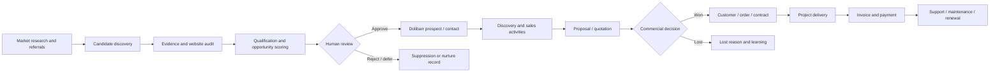
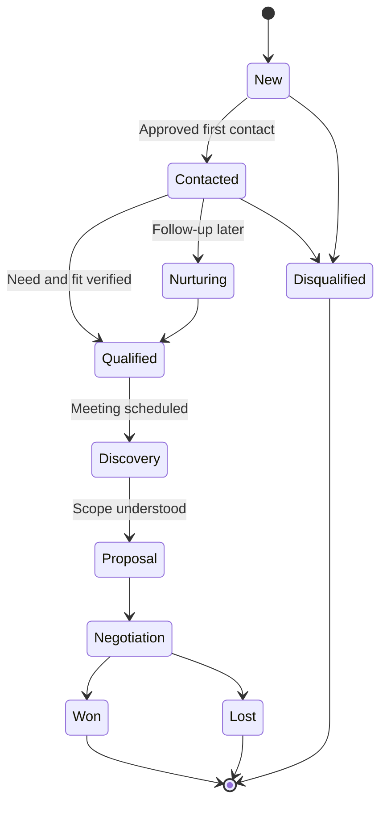
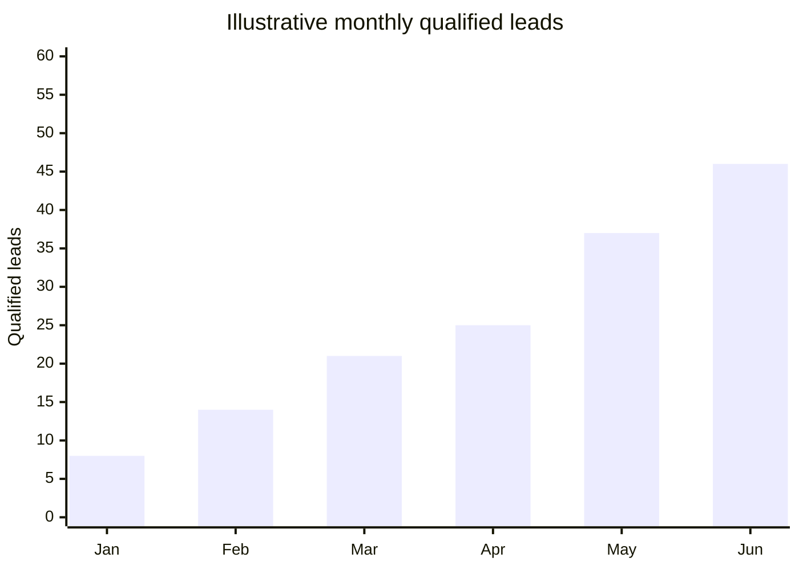
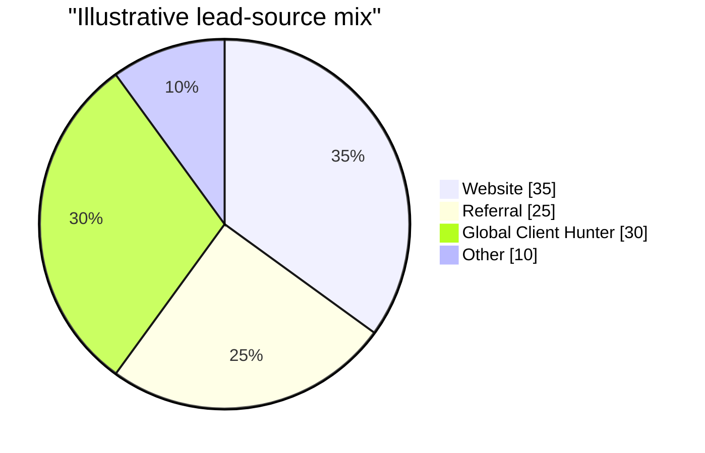
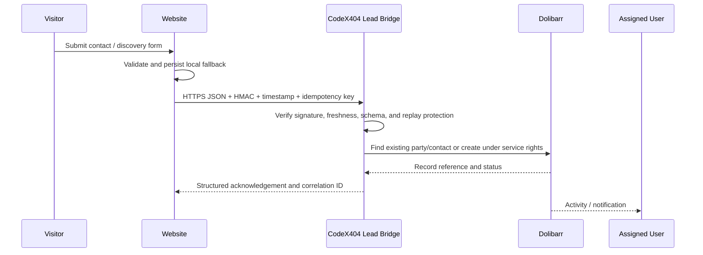
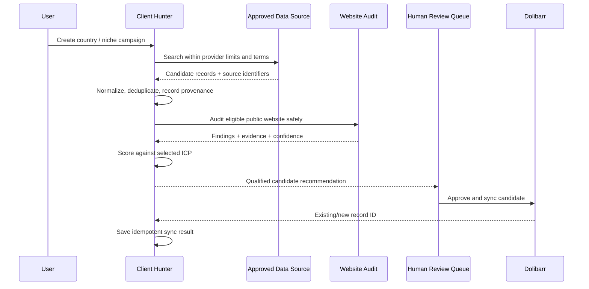
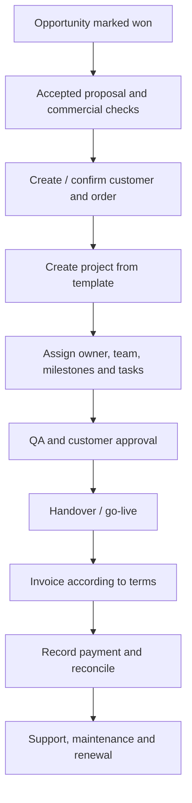

# CodeX404 Business OS — Product Requirements Document

| Document property | Value |
|---|---|
| Product | CodeX404 Business OS |
| Organisation | CodeX404 Solutions |
| Repository | `codex404solutions/CodeX404_solutions` |
| Primary public website | `https://codex404solutions.com/` |
| Proposed Business OS host | `https://business-os.codex404solutions.com/` (unverified; do not configure DNS until approved) |
| ERP/CRM foundation | Dolibarr ERP/CRM, subject to Phase 0 compatibility and licensing review |
| Custom product capability | CodeX404 extensions, including Global Client Hunter |
| Initial operating model | One internal CodeX404 organisation; not a public multi-tenant SaaS in the first release |
| Document status | Proposed requirements baseline; implementation must pass Phase 0 first |
| Version | 2.0 |
| Last revised | 2026-11-21 |

---

## 1. Executive summary

CodeX404 Business OS is the internal operating platform for CodeX404 Solutions. It connects the company's sales, client acquisition, delivery, finance, administration, people operations, and management reporting without rebuilding standard ERP/CRM capabilities that an established platform already provides.

The product has two complementary parts:

1. **Dolibarr ERP/CRM** is the authoritative operational system for companies, contacts, prospects/customers, commercial proposals, orders, invoices, payments, projects, suppliers, products/services, users, permissions, and other enabled native capabilities.
2. **CodeX404 extensions** add differentiated workflows that CodeX404 needs, especially Global Client Hunter, lead intelligence, website opportunity audits, AI-assisted sales preparation, proposal assistance, integration monitoring, and management visualisations.

The system must support domestic and international business development from the beginning. A user must be able to run a campaign for a niche, country, region, city, language, and service category; review source-backed business candidates; assess website and operational opportunities; qualify candidates; and deliberately synchronize approved leads into Dolibarr.

The system is an internal business platform first. A future commercial SaaS offering is a separate product decision requiring tenant isolation, licensing review, hosting redesign, billing, support, privacy controls, and security testing.

## 2. Product vision and operating lifecycle

**Vision:** give CodeX404 a dependable operating system that converts business opportunities into delivered, paid, and supportable client engagements.

Management reporting must reflect this lifecycle using records and events that actually exist in the system. A dashboard must never manufacture leads, revenue, conversion, or delivery progress to make the product look active.

## 3. Company context and service model

The product must support the CodeX404 service model:

| Division | Service families | Typical opportunity signals |
|---|---|---|
| **BUILD** | Websites, e-commerce, web applications, mobile applications, custom software, SaaS, CRM/ERP, APIs, MVPs | Missing/outdated website, broken user journeys, no customer portal, manual business process, product launch need |
| **GROW** | SEO, AEO, GEO, digital marketing, content, social media, lead generation, conversion and analytics | Weak search visibility, poor landing pages, missing conversion tracking, low-quality content structure |
| **AUTOMATE** | AI assistants, chatbots, RAG, agents, document intelligence, workflow automation, WhatsApp/CRM/email automation and integrations | Repetitive manual work, slow response time, disconnected systems, high-volume documents or enquiries |

The system must store service taxonomy and division references as configurable data rather than hard-coding service names in business logic.

## 4. Product goals and measurable outcomes

1. Maintain one authoritative operational record for every company, contact, prospect/customer, commercial document, project, invoice, supplier, and employee.
2. Give the sales team a repeatable process for discovering, qualifying, contacting, and converting domestic and international prospects.
3. Reduce duplicated, stale, unsupported, or low-quality prospect records.
4. Preserve evidence explaining why a business was identified as a potential opportunity.
5. Make lead ownership, next action, due date, and current stage visible.
6. Connect a won deal to an agreed scope, project, milestones, delivery tasks, QA, billing, and support.
7. Provide trustworthy cash-flow, receivables, pipeline, delivery, and workload reporting.
8. Protect client, employee, financial, and prospect information through role-based access and controlled retention.
9. Automate repetitive tasks with observable, retry-safe and reversible workflows.
10. Preserve the public website and its current deployment behaviour.
11. Start with open-source or no-additional-cost capabilities where practical; add paid providers only after approval and a cost/benefit review.
12. Keep the design extensible for future AI, RAG, n8n, and external service integrations without requiring those services for the first operational release.

### 4.1 Success measures

The product must expose measurements, not promise outcomes. Initial measures include:

- Discovery coverage: number of source-backed candidates by campaign and source.
- Qualification rate: qualified leads divided by reviewed candidates.
- Contactability rate: qualified leads with at least one usable, permitted contact channel.
- Outreach response rate: attributable replies divided by delivered outreach attempts.
- Meeting rate: meetings booked divided by contacted qualified leads.
- Proposal rate: proposals created divided by qualified opportunities.
- Win rate: won opportunities divided by closed opportunities.
- Sales cycle: elapsed days between opportunity creation and won/lost decision.
- Pipeline value: open opportunity estimates grouped by currency and stage.
- Cash collection: payments actually recorded, not invoices issued.
- Project health: delivery status based on due milestones, blocked tasks, and approved progress rules.

Baselines and targets are to be established from real operating data after the system has been used. Targets must not be invented in production dashboards.

## 5. Product principles

- **Configure before customising:** enable and validate native Dolibarr functionality before building a replacement.
- **Single source of truth:** do not create parallel ERP/CRM records for information Dolibarr already owns.
- **Evidence before scoring:** every automated opportunity claim should reference its source, observation time, and confidence.
- **Candidate is not a CRM lead:** newly discovered businesses remain in the discovery workspace until reviewed and approved for CRM synchronization.
- **Human-controlled commercial actions:** AI may prepare drafts and recommendations; an authorised person approves outreach, proposals, pricing, discounts, and record-changing actions.
- **Modular boundaries:** use Dolibarr modules and supported extension points; keep external discovery/AI workers behind authenticated APIs.
- **Security by default:** deny access unless explicitly granted; protect each record, file, export, and action.
- **Observable automation:** every scheduled job and integration has status, timestamps, retries, correlation IDs, and safe error information.
- **Truthful analytics:** every KPI has a documented definition, time basis, currency rule, and source of truth.
- **Upgradeability:** never patch Dolibarr core files for CodeX404-specific functionality.
- **Hosting-aware implementation:** no unverified assumption about Docker, Redis, Node.js, Python, workers, root access, or cron frequency on shared hosting.
- **International by design:** use country codes, ISO currencies, IANA time zones, language tags, local display formats, and jurisdiction-aware communication controls.

## 6. Users, roles, and access model

Initial role catalogue (names are examples, not permission grants):

- Super Administrator
- Founder / CEO
- CTO / Technical Lead
- Operations Manager
- Sales Manager
- Business Development / Sales Executive
- Marketing Manager / Executive
- Account Manager
- Project Manager
- Developer / AI-ML Engineer / Designer / QA
- Finance / Accountant
- HR Manager / Recruiter
- Customer Support
- Viewer / Auditor
- External Client (future, only if a restricted portal is deliberately approved)

A user may need more than one role. The team must verify whether the selected Dolibarr release and configuration meet the required role and record-scope semantics. Do not infer that a role name automatically grants access.

### 6.1 Access scopes

Where required and supported, permissions should cover company-wide, department/team, record owner, assigned user, project member, customer relationship, and self-only scopes. Record-level filtering must happen on the server and apply to list views, search, APIs, dashboards, exports, attachments, and background jobs.

### 6.2 Access expectations

| Role | Typical permitted work |
|---|---|
| Founder / CEO | Company overview and approved financial/commercial visibility |
| CTO | Technical delivery, architecture, workload, blockers, and granted project financial context |
| Sales | Assigned candidates/leads, contacts, opportunities, activities, and proposals |
| Marketing | Approved campaigns, attribution, and permitted lead data |
| Project Manager | Assigned projects, tasks, milestones, delivery documents, and granted budget data |
| Developer / QA | Assigned requirements, tasks, repositories/links, and approved project files |
| Finance | Invoices, payments, expenses, receivables, procurement, and accounting records |
| HR | Employee and recruitment records within HR scope |
| Support | Assigned tickets and minimum client context required to resolve them |
| Viewer / Auditor | Read-only access to explicitly granted records and reports |

No ordinary employee role should automatically expose all HR records, owner-only financial data, credentials, private client files, or all business-development intelligence.

## 7. Functional scope and requirements

Requirement identifiers are stable references for the implementation matrix and test cases. Priority is assigned in Section 12.

### 7.1 Core platform and administration

- **BUS-CORE-001** — Maintain the CodeX404 organisation profile, legal/trading name, registered details, address, contact channels, logo, fiscal configuration, and identifiers.
- **BUS-CORE-002** — Manage users, groups, rights, user status, password lifecycle, sessions, and access review.
- **BUS-CORE-003** — Restrict system configuration to authorised administrators.
- **BUS-CORE-004** — Provide notification and activity history for material business events.
- **BUS-CORE-005** — Audit permission changes, financial state changes, imports, exports, approvals, and integration administration.
- **BUS-CORE-006** — Provide global search limited to records the current user may access.
- **BUS-CORE-007** — Support validated import/export with mapping preview, error report, access check, and audit entry.
- **BUS-CORE-008** — Configure safe references/numbering for proposals, orders, invoices, projects, and custom records.
- **BUS-CORE-009** — Support configured currencies where the selected Dolibarr configuration supports the required workflow.
- **BUS-CORE-010** — Document backup, restore, recovery objectives, and restore-test evidence.

### 7.2 CRM and account management

- **BUS-CRM-001** — Capture prospects from the website, discovery calls, referrals, approved outreach, partners, events, manual entry, imports, and authorised APIs.
- **BUS-CRM-002** — Maintain company and contact records with name, domain, address, country, industry, email, phone, role, language, time zone, owner, and source where available.
- **BUS-CRM-003** — Record service interest, division, business problem, budget range (when supplied), expected timeline, priority, tags, and notes.
- **BUS-CRM-004** — Record calls, emails, meetings, demos, discovery sessions, follow-ups, notes, and tasks.
- **BUS-CRM-005** — Show a chronological, permission-filtered activity history.
- **BUS-CRM-006** — Detect possible duplicates using normalized domain, email, telephone, external source identifier, and name/address evidence.
- **BUS-CRM-007** — Support a controlled merge with field conflict review, retained identifiers, and audit history.
- **BUS-CRM-008** — Assign ownership and team responsibility.
- **BUS-CRM-009** — Track next action, due date, overdue status, and reminder delivery.
- **BUS-CRM-010** — Store communication preferences, suppression status, source provenance, and consent/lawful-basis review metadata appropriate to the applicable jurisdiction.
- **BUS-CRM-011** — Maintain a clear separation between an unreviewed discovery candidate and a qualified CRM prospect.

Preferred sales lifecycle (map to the selected native Dolibarr workflow after inspection):

Stage transitions must be logged. A lead may not be marked as contacted unless a real activity was recorded. A deal may not be marked won without the authorised commercial decision and required documentation.

### 7.3 Global Client Hunter — international lead discovery

This is a differentiating CodeX404 capability. It is an intelligence and candidate-research workspace, not a replacement CRM.

#### Campaign and targeting

- **BUS-HUNT-001** — Create one-time or recurring lead-discovery campaigns with name, owner, purpose, budget/usage limit, target quantity, status, and schedule.
- **BUS-HUNT-002** — Target any supported country and optionally region/state, city, postcode, radius, language, business category, niche, company size band, and business keywords.
- **BUS-HUNT-003** — Select service intent from BUILD, GROW, and AUTOMATE taxonomy, including one or more specific services.
- **BUS-HUNT-004** — Apply prospect filters such as website present/missing, website status, public contact availability, business category, and minimum evidence/score thresholds.
- **BUS-HUNT-005** — Support multiple concurrent campaigns without mixing records or attribution.
- **BUS-HUNT-006** — Display the source/provider used, query parameters, collection time, source record identifier, and provider limitations.

#### Source connectors

- **BUS-HUNT-010** — Implement provider adapters behind a common connector interface.
- **BUS-HUNT-011** — Prioritise official APIs, permitted public directories, licensed datasets, user-authorised imports, and other sources whose terms allow the intended use.
- **BUS-HUNT-012** — Support CSV/XLSX import with schema mapping, validation, deduplication preview, and import audit.
- **BUS-HUNT-013** — Do not bypass authentication, CAPTCHA, rate limits, robots controls, paywalls, or a provider's terms of service.
- **BUS-HUNT-014** — Apply provider-specific rate limits, quotas, retries, caching, and backoff.
- **BUS-HUNT-015** — Make source adapters replaceable so a provider change does not rewrite the qualification domain.

#### Candidate research and enrichment

- **BUS-HUNT-020** — Normalize company name, website/domain, country, region, city, business category, address, and source identifiers.
- **BUS-HUNT-021** — Capture public business contact channels only where the collection method and intended use are permitted.
- **BUS-HUNT-022** — Store contact evidence, source URL, observation date, confidence, and verification status separately from the canonical CRM contact.
- **BUS-HUNT-023** — Detect duplicates and probable company matches before CRM synchronization.
- **BUS-HUNT-024** — Track source freshness and mark stale observations for revalidation.
- **BUS-HUNT-025** — Keep personal contact data to the minimum required for a legitimate business purpose; do not infer sensitive personal attributes.

#### Website intelligence and opportunity analysis

- **BUS-HUNT-030** — Audit a candidate website only after applying SSRF protections and permitted-access checks.
- **BUS-HUNT-031** — Evaluate measurable signals such as TLS/HTTPS reachability, mobile viewport behaviour, broken links, basic performance, metadata/SEO structure, accessibility indicators, visible inquiry paths, and technology hints where reliably detectable.
- **BUS-HUNT-032** — Store every finding with evidence URL, timestamp, test method, severity, confidence, and a clear distinction between observation and inference.
- **BUS-HUNT-033** — Identify possible service opportunities, such as website rebuild, booking workflow, CRM integration, e-commerce improvement, analytics setup, or workflow automation.
- **BUS-HUNT-034** — Never claim that a business has a business-process problem solely because a crawler could not observe a feature.
- **BUS-HUNT-035** — Generate an opportunity report with evidence, caveats, recommended CodeX404 service, and suggested discovery questions.

#### Qualification and scoring

- **BUS-HUNT-040** — Define configurable ICP profiles by niche, geography, company characteristics, and CodeX404 service fit.
- **BUS-HUNT-041** — Compute a transparent rule-based score first; optional AI reasoning may explain and enrich but must not silently alter the deterministic score.
- **BUS-HUNT-042** — Show component scores, evidence, confidence, score version, and last-calculated time.
- **BUS-HUNT-043** — Separate fit, need/opportunity, contactability, source confidence, and compliance eligibility dimensions.
- **BUS-HUNT-044** — Support hot/warm/cold labels only as configurable presentation bands; score thresholds must be calibrated using actual conversion data.
- **BUS-HUNT-045** — Allow authorised users to override a score with a reason; retain both calculated and overridden values.
- **BUS-HUNT-046** — Exclude suppressed, opted-out, invalid, duplicate, or legally restricted contacts from outreach selection.

#### Dolibarr synchronization

- **BUS-HUNT-050** — Provide a review queue for candidates proposed for CRM synchronization.
- **BUS-HUNT-051** — Check for existing Dolibarr third-party/contact records before create/update.
- **BUS-HUNT-052** — Create/update Dolibarr records only through supported APIs or reviewed module services.
- **BUS-HUNT-053** — Store a source/campaign reference and discovery report reference without duplicating the whole candidate history into the ERP.
- **BUS-HUNT-054** — Record sync outcome, external record identifier, correlation ID, and failure reason.
- **BUS-HUNT-055** — Support replay-safe, idempotent synchronization and manual conflict resolution.

#### International readiness

- **BUS-HUNT-060** — Store ISO 3166-1 alpha-2 country codes and region codes when available.
- **BUS-HUNT-061** — Store ISO 4217 currency codes for opportunity estimates; retain the original currency and amount.
- **BUS-HUNT-062** — Store IANA time-zone identifiers and display due dates in the user's configured time zone.
- **BUS-HUNT-063** — Store language using BCP 47 language tags where applicable.
- **BUS-HUNT-064** — Support localized address, phone, date, number, and currency presentation without changing stored canonical values.
- **BUS-HUNT-065** — Keep exchange-rate source and observation timestamp when converted values are used for reporting; never silently combine currencies.
- **BUS-HUNT-066** — Apply jurisdiction-specific privacy and direct-marketing review before enabling contact workflows for a country.

### 7.4 Sales, services, and proposals

- **BUS-SALES-001** — Maintain a configurable BUILD/GROW/AUTOMATE service catalogue with description, scope template, unit, indicative pricing guidance, currency, and active status.
- **BUS-SALES-002** — Create and revise commercial proposals/quotations using native Dolibarr functionality wherever possible.
- **BUS-SALES-003** — Store scope, assumptions, exclusions, deliverables, milestones, timeline, payment terms, expiry date, and customer acceptance state.
- **BUS-SALES-004** — Keep proposal versions and approval history where the native workflow or an approved extension supports it.
- **BUS-SALES-005** — Require authorised approval for discounts, non-standard terms, and price exceptions.
- **BUS-SALES-006** — Create order/project records from accepted commercial documents through a controlled workflow.
- **BUS-SALES-007** — AI may draft scope and proposal language from approved templates; a human must review facts, price, tax, timeline, and terms before sending.

### 7.5 Customer, project, and delivery management

- **BUS-DEL-001** — Convert a won opportunity into the appropriate customer/order/project records without duplicate company creation.
- **BUS-DEL-002** — Use project templates for common website, application, AI, automation, and marketing engagements.
- **BUS-DEL-003** — Track project owner, customer, scope, status, priority, budget, planned dates, milestones, team, and risks.
- **BUS-DEL-004** — Track tasks, assignees, due dates, dependencies where supported, estimates, actual time, blockers, and completion evidence.
- **BUS-DEL-005** — Track deliverables, review, QA, customer approval, handover, and release status.
- **BUS-DEL-006** — Keep project documents private by default.
- **BUS-DEL-007** — Publish a project/case study to the public website only through a separate client-permission and publication approval process.
- **BUS-DEL-008** — Track maintenance/retainer entitlement, start/end dates, renewal reminders, and support ownership where required.

### 7.6 Finance and accounting

- **BUS-FIN-001** — Use Dolibarr native invoices, invoice lines, payment records, credit notes, bank/cash records, and accounting capabilities after configuration review.
- **BUS-FIN-002** — Record amounts using fixed-precision decimal values and an explicit currency.
- **BUS-FIN-003** — Distinguish quoted, ordered, invoiced, due, overdue, partially paid, paid, credited, and written-off states.
- **BUS-FIN-004** — Support deposits and partial payments if the selected version/configuration supports the required workflow.
- **BUS-FIN-005** — Track expenses and supplier invoices where enabled.
- **BUS-FIN-006** — Provide receivable ageing and cash-collection reporting.
- **BUS-FIN-007** — Keep tax rates and statutory settings configurable and professionally reviewed; do not hard-code tax assumptions.
- **BUS-FIN-008** — Use adjustment/reversal/credit-note processes rather than silently rewriting posted financial history.
- **BUS-FIN-009** — Support multiple sales currencies only after end-to-end testing of proposals, invoices, payments, exchange-rate treatment, and reporting.

### 7.7 Procurement, suppliers, stock, and assets

- **BUS-OPS-001** — Maintain suppliers and supplier contacts in Dolibarr.
- **BUS-OPS-002** — Track purchase requests, purchase orders, vendor invoices, and payment state where enabled.
- **BUS-OPS-003** — Enable stock/inventory only if CodeX404 has a real inventory use case.
- **BUS-OPS-004** — Maintain an asset register only if required, with owner, location, acquisition, warranty, status, and disposal history.
- **BUS-OPS-005** — Enforce approval thresholds for non-routine purchases if the native platform cannot cover the policy.

### 7.8 HR and recruitment

- **BUS-HR-001** — Maintain employee and permitted HR records with strict HR permissions.
- **BUS-HR-002** — Track recruitment vacancies, candidate stages, interviews, and decisions only if the selected module/workflow has been verified.
- **BUS-HR-003** — Track leave or attendance only after validating native coverage and legal/operational requirements.
- **BUS-HR-004** — Do not claim payroll, statutory deductions, or legal HR compliance without a separate verified solution and professional review.

### 7.9 Marketing, support, and documents

- **BUS-MKT-001** — Attribute leads to source, campaign, medium, and approved UTM information.
- **BUS-MKT-002** — Track communication preferences and suppression state before campaign selection.
- **BUS-SUP-001** — Manage support requests, assignee, status, priority, response, resolution, and linked customer/project where a verified support workflow is enabled.
- **BUS-DOC-001** — Store business documents with classification, owner, access rule, version/reference, and retention policy.
- **BUS-DOC-002** — Require approval for publication, contract changes, financial adjustments, and sensitive data exports.

### 7.10 Management dashboards, graphs, and charts

- **BUS-BI-001** — Provide role-aware dashboards for leadership, sales, marketing, finance, delivery, and operations.
- **BUS-BI-002** — Use KPI cards for current values, trend charts for change over time, bar charts for comparisons, funnel charts for lifecycle conversion, and tables for auditable detail.
- **BUS-BI-003** — Each metric must have a documented formula, source, period, timezone, currency basis, filters, and refresh time.
- **BUS-BI-004** — Support drill-down from a chart segment to the underlying permitted records.
- **BUS-BI-005** — Provide date-range, country, campaign, division, owner, service, currency, and status filters where appropriate.
- **BUS-BI-006** — Display a clear no-data state; never substitute demonstration numbers in a production environment.
- **BUS-BI-007** — Use server-side aggregation and pagination; charts must not retrieve an unrestricted dataset into the browser.
- **BUS-BI-008** — Provide export only to authorised roles and log sensitive exports.
- **BUS-BI-009** — Label estimates separately from actuals and invoiced revenue separately from cash received.

Recommended executive dashboard components:

| Visualisation | Business question | Metric / dimension |
|---|---|---|
| KPI cards | What is the current position? | Qualified leads, open pipeline, cash collected, overdue invoices, active projects |
| Line chart | How is performance changing? | Weekly/monthly leads, replies, proposals, cash collected |
| Funnel | Where do opportunities drop? | Candidate → qualified → contacted → meeting → proposal → won |
| Horizontal bar | Which sources/markets perform best? | Qualified leads or wins by country, industry, source, or campaign |
| Stacked bar | What is the composition? | Pipeline by stage and division; projects by status |
| Donut chart | What is the mix? | Lead sources or service mix, only when category count is small |
| Heatmap | Where are opportunities concentrated? | Country/city versus industry, or owner versus overdue work |
| Receivables ageing | What money is outstanding? | Current, 1–30, 31–60, 61–90, 90+ days; exact policy to be configured |
| Project health table | Which delivery needs attention? | Overdue milestones, blocked tasks, risk status, owner |

### 7.10.1 KPI definition catalogue

The following formulas are initial definitions. Confirm the exact native fields and event timestamps during Phase 0 before implementing them. Use the same definition in every report and export.

| KPI | Initial definition | Important interpretation rule |
|---|---|---|
| Unique candidates | Count of distinct candidate IDs in the selected campaign/time cohort | Deduplicate before counting; do not count source observations as separate businesses |
| Reviewed candidates | Candidates with a recorded human review decision | Exclude candidates still waiting in the queue |
| Qualification rate | Qualified candidates ÷ reviewed candidates × 100 | Show numerator and denominator; avoid dividing by all raw source rows |
| Contactability rate | Qualified candidates with at least one valid, permitted channel ÷ qualified candidates × 100 | A detected email is not automatically valid or permitted for outreach |
| Sync success rate | Successfully synchronized approved candidates ÷ candidates approved for sync × 100 | Exclude pending attempts from failures until their retry window expires |
| Reply rate | Unique leads with a substantive reply ÷ leads with a confirmed delivered outreach message × 100 | Keep bounces, auto-replies, and delivery failures separately classified |
| Meeting conversion | Qualified leads with a booked meeting ÷ qualified leads with an approved outreach attempt × 100 | Define cohort and time window consistently |
| Proposal rate | Opportunities with a proposal issued ÷ qualified opportunities reaching proposal eligibility × 100 | Do not count draft proposals as issued |
| Win rate | Won opportunities ÷ (won + lost opportunities) × 100 | Open opportunities are excluded from this denominator |
| Sales cycle | Median elapsed calendar days from the configured opportunity start event to won date | State the start event and timezone; show median to reduce outlier distortion |
| Open pipeline | Sum of open opportunity values grouped by currency and stage | Do not sum unlike currencies; distinguish weighted from unweighted pipeline |
| Cash collected | Sum of confirmed payment records in the selected period and currency | Do not substitute invoices issued or proposals accepted |
| Overdue receivable | Outstanding invoice balance whose due date is before the report date | Apply credit notes/partial payments and display ageing bands |
| Milestone on-time rate | Milestones completed on/before due date ÷ milestones due in the selected cohort × 100 | Exclude milestones not yet due; handle revised due dates by a documented policy |

Metrics must define the date field used for cohorting (created, qualified, contacted, proposal issued, won, invoice date, due date, payment date, or milestone due date). Charts must show that context in a tooltip or subtitle.

Illustrative chart only — not actual CodeX404 performance data:

## 8. End-to-end workflows

### 8.1 Website enquiry to Dolibarr

The website must not report a successful ERP sync unless the receiving system confirms success. Local persistence remains a recovery path.

### 8.2 Global candidate to CRM prospect

### 8.3 Won deal to delivery and finance

### 8.4 Procurement to payment

A purchase request (if used) is reviewed, approved under policy, converted to a purchase order, matched to a supplier invoice, checked, and paid by an authorised finance user. A requested, ordered, invoiced, and paid amount must be reported separately.

## 9. Non-functional requirements

- **Availability:** target a service level only after hosting and backup capabilities are verified; the first version must expose maintenance and integration-failure states.
- **Performance:** paginate lists, limit expensive reports, cache only safe non-sensitive aggregates, and run discovery/audit work in bounded background batches.
- **Scalability:** internal single-organisation use first; scale discovery workers independently if campaign volume requires it.
- **Reliability:** retries must be idempotent; failures must be visible and recoverable.
- **Security:** follow `SECURITY.md`; server-side authorisation and secure document access are mandatory.
- **Compatibility:** pin and test the selected Dolibarr, PHP, database, and extension versions.
- **Accessibility:** keyboard support, labels, contrast, chart alternatives, and non-colour status cues.
- **Internationalisation:** canonical codes and locale-aware presentation.
- **Maintainability:** documented module contracts, migration scripts, test coverage, and small reviewable changes.
- **Portability:** separate application configuration from source; avoid undocumented host-specific assumptions.

## 10. Prioritisation

### P0 — Operational foundation

- Phase 0 technical, hosting, repository, license, and native-feature audit.
- Separate staging application and database.
- Dolibarr baseline, organisation setup, users, permissions, and core CRM/sales configuration.
- Website lead bridge with HMAC, timestamp, idempotency, audit, and fallback.
- Basic lead lifecycle, activities, products/services, proposals, projects, invoices, and payments.
- Backup/restore test and security baseline.
- Role-aware basic dashboard with KPI cards and auditable tables.

### P1 — Global acquisition and complete operations

- Global Client Hunter campaigns and connector framework.
- Approved source adapters and CSV import.
- Candidate staging, provenance, deduplication, website audit, and transparent score.
- Human review and idempotent sync into Dolibarr.
- International country/currency/timezone/language support.
- Outreach drafting and suppression controls.
- Sales funnel, country/source performance charts, receivables ageing, and project health visuals.
- Supplier, support, marketing attribution, and required HR workflows after verification.

### P2 — Advanced intelligence and automation

- Independent Python/FastAPI worker service on suitable infrastructure.
- AI-assisted ICP reasoning and proposal drafting with approved sources.
- RAG over approved company documents.
- Controlled automation workflows and external connectors.
- Advanced cohort analysis, conversion attribution, forecasting, and capacity analytics.
- Multi-entity or SaaS architecture only after a separate business/security decision.

### Explicitly deferred

- Rebuilding Dolibarr accounting, invoice, contact, or project engines.
- Public multi-tenant SaaS registration and subscription billing.
- Autonomous mass emailing or LinkedIn automation.
- Automated pricing or contract commitments by AI.
- Payroll/statutory compliance claims without a verified specialist solution.
- Unrestricted scraping or provider access that violates terms or applicable law.
- Production deployment before explicit owner approval.

## 11. Acceptance criteria

A requirement is accepted only when:
1. Its native/config/custom/deferred implementation is recorded in the module matrix.
2. Its UI, API, permission, validation, persistence, and audit behaviour are tested where applicable.
3. Its data is traceable to an authoritative source.
4. A failure path and recovery procedure are defined.
5. The corresponding documentation and test evidence are updated.
6. No production website, database, or deployment path was changed outside approved scope.

## 12. Open decisions to resolve in Phase 0

- Exact Dolibarr release and required PHP/database compatibility.
- Actual Hostinger plan capabilities, cron frequency, document-root separation, and secure storage support.
- Whether the first release can host Dolibarr safely on current shared hosting or needs a VPS.
- Native feature coverage for prospect lifecycle, project tasks, HR, reporting, and role scopes.
- Exact Business OS hostname and DNS/document-root mapping.
- Whether the AI/discovery engine begins as bounded PHP cron jobs or is deferred to a separate Python service.
- Approved discovery data providers and their terms, quotas, and cost.
- Country-specific privacy/direct-marketing review for target markets.
- Accounting and tax configuration review by a qualified professional.

No open decision should be silently treated as approved.
