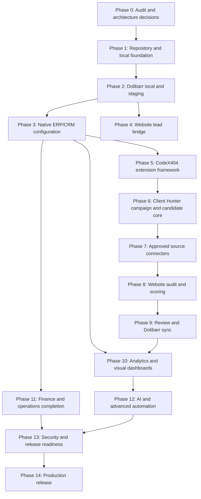

# CodeX404 Business OS — Phased Implementation Plan

| Property | Value |
|---|---|
| Delivery method | Gate-based, staged, owner-approved implementation |
| Working branch | `dev` or feature branch from `dev` |
| Production branch | `main` (protected; no direct development) |
| First mandatory activity | Phase 0 audit only |
| Current implementation status | Not started; this document is a plan, not deployment evidence |
| Version | 2.0 |

---

## 1. Delivery strategy

Implement CodeX404 Business OS in small, verifiable phases. The goal is a reliable internal operating platform, not a large speculative build.

The work order is:
1. Verify the repository, hosting, Dolibarr fit, licensing, and current website integration.
2. Establish safe local/staging foundations.
3. Configure native Dolibarr modules.
4. Stabilise the website-to-Business-OS lead bridge.
5. Build CodeX404 extensions only for verified gaps.
6. Build Global Client Hunter as a pre-CRM discovery and qualification system.
7. Add auditable analytics and role-aware graphical dashboards.
8. Add advanced AI/automation only when the data, security, and runtime foundations are reliable.

No calendar estimates should be committed until the developer capacity, hosting, selected release, and scope are known.

## 2. Dependency overview

The dependency graph does not mean every module must be complete before another begins. It identifies minimum gates; parallel work is allowed only when its data/permission contract is stable.

## Phase 0 — Repository, website, hosting, Dolibarr, and licence audit

### 0.1 Repository audit
- [ ] Record Git branch, clean/dirty state, commit, and remotes.
- [ ] Inspect repository tree and current documentation.
- [ ] Identify actual code versus planned/legacy folders.
- [ ] Inspect tracked/untracked secrets by file path and metadata only; do not print secret contents.
- [ ] Review `.gitignore`, GitHub Actions permissions, branch protection, and repository visibility.
- [ ] Record existing deployment paths and excluded directories.

### 0.2 Website and integration audit
- [ ] Inspect `website/contact.php` and `website/discovery-call.php`.
- [ ] Inspect `ContactController.php`, `LeadController.php`, `CRMIntegrationService.php`, `EmailService.php`, `FormValidator.php`, and `website/includes/security.php`.
- [ ] Verify local lead persistence, JSON structure, retention, and current error states.
- [ ] Verify HMAC raw-body signing, timestamp header, idempotency key, timeout, and HTTPS verification in code.
- [ ] Inspect website admin authentication and its separation from Business OS identity.
- [ ] Inspect `ProjectService.php` and project publication/client-permission states.
- [ ] Inspect `.github/workflows/deploy.yml` without modifying it.
- [ ] Capture current website smoke-test baseline.

### 0.3 Hosting and runtime audit
- [ ] Confirm Hostinger plan and account capabilities with account owner.
- [ ] Confirm PHP version and required extensions.
- [ ] Confirm MySQL/MariaDB version, engine support, database limits, and user privileges.
- [ ] Confirm subdomain/document-root separation and private storage outside public root.
- [ ] Confirm memory, execution time, upload/request size, disk, and connection limits.
- [ ] Confirm cron availability/frequency and whether long-running processes are prohibited.
- [ ] Confirm HTTPS, FTPS/SFTP, certificate/host-key validation, backup, and restore options.
- [ ] Do not assume Docker, Node, Python, Redis, RabbitMQ, root access, or persistent workers are available.

### 0.4 Dolibarr fit and licensing audit
- [ ] Identify the current stable maintained release candidate.
- [ ] Verify the release's PHP, DB, extension, storage, and web-server requirements against the real host.
- [ ] Review official release notes, developer docs, licence, and third-party notices.
- [ ] Inventory standard modules relevant to CodeX404.
- [ ] Map every P0/P1 PRD requirement to native/config/custom/external/deferred.
- [ ] Verify prospect/opportunity, task, HR, reporting, multicurrency, entity, and rights behaviour in a local test install.
- [ ] Review community add-ons only after licence, compatibility, security, and maintenance checks.
- [ ] Identify whether shared hosting is acceptable or a VPS is required.

### 0.5 Required Phase 0 outputs
- [ ] `ENVIRONMENT_AUDIT.md`
- [ ] `MODULE_MATRIX.md`
- [ ] `LICENSING_REVIEW.md`
- [ ] `BUSINESS_OS_DECISIONS.md` / ADR log
- [ ] Website integration contract notes and regression baseline
- [ ] Updated deployment topology and risk register

**Exit gate:** Owner approves platform, licence, hosting, domain, and scope decisions. If any critical compatibility blocker remains, do not proceed to installation/deployment.

## Phase 1 — Safe repository and development foundation

- [ ] Confirm feature branch from `dev`.
- [ ] Create/confirm `docs/Business-OS/` documentation baseline.
- [ ] Create `business-os/` workspace only after Phase 0 approval.
- [ ] Add secure `.gitignore` rules for runtime config, uploads, generated documents, logs, and backups.
- [ ] Define code style, PHP compatibility, module naming, API contract, and test conventions.
- [ ] Create local development instructions and synthetic test data.
- [ ] Preserve `website/` and existing deploy workflow unchanged.
- [ ] Define CI checks that do not require production credentials.

**Exit gate:** Repository boundaries and development workflow are verified; no secret or website deployment regression.

## Phase 2 — Local Dolibarr baseline and staging

- [ ] Obtain the approved official Dolibarr release.
- [ ] Verify distribution integrity where official checksums/signatures are published.
- [ ] Install locally with a separate database and protected document directory.
- [ ] Configure a synthetic CodeX404 organisation and test users.
- [ ] Complete setup and secure/disable installer access according to release guidance.
- [ ] Enable only the minimum required native modules.
- [ ] Test database/document permissions and logging.
- [ ] Create a local backup and restore it to an isolated environment.
- [ ] Build staging only after host and DNS are approved.
- [ ] Use separate staging database, credentials, storage, SMTP, and API tokens.
- [ ] Restrict staging access; disable real external messaging and payment actions.
- [ ] Verify staging does not overlap the public website root.

**Exit gate:** Local and staging smoke tests pass, with a successful restore and clear separation from the public website.

## Phase 3 — Native ERP/CRM configuration and gap matrix

- [ ] Configure CodeX404 company identity and default locale/currency.
- [ ] Configure users, groups, rights, and test role scenarios.
- [ ] Configure third parties, contacts, leads/prospects, source attribution, and activities.
- [ ] Configure opportunity/pipeline behaviour if supported by the chosen release or approved extension.
- [ ] Configure BUILD/GROW/AUTOMATE service catalogue.
- [ ] Configure proposals, orders, invoices, payments, and required terms.
- [ ] Configure projects, tasks, agenda, milestones, and document workflow.
- [ ] Configure suppliers/purchases only if needed.
- [ ] Configure HR/support only after native fit and privacy review.
- [ ] Configure accounting/taxes only after accountant review.
- [ ] Complete `MODULE_MATRIX.md` with observed evidence and tests.

**Exit gate:** Native workflows cover agreed P0 requirements or remaining gaps have approved owners and implementation decisions.

## Phase 4 — Website lead bridge

- [ ] Inspect current website payload exactly; do not guess fields.
- [ ] Preserve local JSON fallback and truthful sync status.
- [ ] Implement a release-compatible receiver in the approved module/API boundary.
- [ ] Verify HTTPS and exact raw-body HMAC.
- [ ] Enforce timestamp freshness and unique idempotency key.
- [ ] Validate payload schema, size, field lengths, and allowlisted values.
- [ ] Reject client-controlled status, owner, permissions, pricing, and payment fields.
- [ ] Find existing company/contact before creating a new record.
- [ ] Apply least-privilege integration user.
- [ ] Return structured acknowledgement, object reference, and correlation ID.
- [ ] Add bounded retry/outbox if host scheduling supports it.
- [ ] Test valid, duplicate, invalid-signature, stale-timestamp, malformed, oversized, timeout, and temporary DB-failure cases.
- [ ] Confirm website shows `pending`/`failed` versus `synced` correctly.

**Exit gate:** End-to-end staging tests pass without duplicate CRM records; website fallback works during ERP outage.

## Phase 5 — CodeX404 extension framework

- [ ] Create one minimal custom module descriptor and installation/upgrade path.
- [ ] Verify custom menus, permissions, hook/trigger registration, language strings, and assets.
- [ ] Define extension table naming/entity rules.
- [ ] Define module logging, audit, error, and feature-flag patterns.
- [ ] Add CI checks and install/upgrade tests.
- [ ] Implement only gaps listed as custom in `MODULE_MATRIX.md`.

**Exit gate:** Module can be installed, upgraded, disabled, and tested without modifying Dolibarr core.

## Phase 6 — Global Client Hunter foundation

- [ ] Define campaign, candidate, observation, evidence, score, suppression, and sync state models.
- [ ] Implement candidate staging separate from Dolibarr prospects.
- [ ] Add campaign create/edit/pause/cancel and ownership.
- [ ] Add targeting schema for country, region, city, industry, niche, language, and service taxonomy.
- [ ] Implement normalization and duplicate detection.
- [ ] Add candidate review queue and reason codes.
- [ ] Add retention, suppression, and source-provenance handling.
- [ ] Add campaign run logs, quota counters, and cancel/kill controls.

**Exit gate:** Synthetic campaign can be created, populated from an authorised test import, deduplicated, reviewed, and expired without creating duplicate CRM contacts.

## Phase 7 — Provider connectors and international search

- [ ] Create provider adapter interface and connector inventory.
- [ ] Review permitted use, terms, API keys, rate limits, fields, and costs for each source.
- [ ] Implement CSV/XLSX import with validation and dry-run preview.
- [ ] Implement first approved public/official provider connector.
- [ ] Implement country/city and industry query mapping.
- [ ] Implement provider quotas, backoff, caching, and bounded retries.
- [ ] Add country, currency, language, timezone, and contact provenance fields.
- [ ] Add connector health view and per-provider kill switch.
- [ ] Test quota exhaustion, provider outage, malformed data, and partial results.

**Exit gate:** At least one approved source produces reproducible, source-attributed candidates within provider terms and request limits.

## Phase 8 — Website intelligence and opportunity scoring

- [ ] Implement crawler URL validation and SSRF protections.
- [ ] Enforce DNS/redirect checks, blocked IP ranges, response size/time/depth limits, and allowed content types.
- [ ] Implement bounded website audit checks with explicit test versions.
- [ ] Store findings with evidence URL, timestamp, confidence, and fact/inference classification.
- [ ] Define configurable ICP profiles.
- [ ] Implement deterministic scoring components and versioning.
- [ ] Separate business fit, opportunity/need, contactability, source confidence, and compliance eligibility.
- [ ] Add optional AI explanation grounded in evidence references.
- [ ] Calibrate thresholds using real reviewed/conversion data; keep initial thresholds configurable.
- [ ] Test crawler failures and unknown states to ensure they are not represented as confirmed deficiencies.

**Exit gate:** Candidate report is explainable, source-backed, privacy-reviewed, and safe against SSRF/resource abuse.

## Phase 9 — Human review, Dolibarr synchronization, and sales assistant

- [ ] Build approve/defer/reject/suppress review actions.
- [ ] Check existing Dolibarr third-party/contact by normalized domain and available identifiers.
- [ ] Implement an idempotent create/update sync service using supported API/module patterns.
- [ ] Store source campaign and candidate reference on the CRM record using approved fields.
- [ ] Add conflict resolution and sync retry/dead-letter screen.
- [ ] Generate outreach drafts using verified evidence and approved templates.
- [ ] Add approval, opt-out, country/channel policy, and contact-suppression checks.
- [ ] Require human approval before sending any message in the initial release.
- [ ] Log communication activity in Dolibarr only when it actually occurred.

**Exit gate:** A reviewed candidate synchronizes once; retries do not create duplicates; outreach remains draft until approved.

## Phase 10 — Analytics, graphical dashboards, and reporting

- [ ] Define a metric catalogue with formula, owner, source, currency, timezone, filter, and refresh policy.
- [ ] Build role-aware KPI cards.
- [ ] Build sales funnel and stage-conversion charts.
- [ ] Build lead trends and campaign/source/country/service comparisons.
- [ ] Build Client Hunter score distribution and source-health visualisations.
- [ ] Build finance receivables ageing and cash-collection charts.
- [ ] Build project health, milestone, and task workload views.
- [ ] Implement server-side aggregation, permission checks, and drill-down.
- [ ] Add text/table alternative, empty/loading/error state, refresh timestamp, and currency/timezone context.
- [ ] Validate every chart against a manual query/sample set and real records.
- [ ] Prevent demo/sample metrics from appearing in production.

**Exit gate:** Role-based dashboards reconcile to source records and cannot leak restricted counts or values.

## Phase 11 — Finance, delivery, procurement, HR, and support completion

- [ ] Test proposal → accepted order → project → invoice → payment flow.
- [ ] Test partial payment, overdue, adjustment, refund/credit-note path where applicable.
- [ ] Test expense and supplier invoice workflows.
- [ ] Complete accountant review of tax/accounting settings.
- [ ] Complete project template, milestone, QA, approval, and handover process.
- [ ] Enable procurement/assets only if needed.
- [ ] Enable HR/support only after permission and retention review.
- [ ] Document any business function that requires a separate specialist system.

**Exit gate:** Agreed business workflows are tested end-to-end with synthetic/staging records and professional review where required.

## Phase 12 — AI and advanced automation

Deferred until records, permissions, and runtime are stable:
- [ ] Decide whether a separate Python/FastAPI service is needed.
- [ ] Deploy only to a verified suitable runtime (not assumed on shared hosting).
- [ ] Define read-only AI use cases first.
- [ ] Implement permission-aware, allowlisted tools.
- [ ] Add evidence-grounded RAG over approved company documents if required.
- [ ] Redact/minimise PII before model calls.
- [ ] Require approval for write actions and external communications.
- [ ] Audit each tool invocation and result.
- [ ] Add model timeout, fallback, cost limit, and kill switch.
- [ ] Test prompt injection, data leakage, and unauthorised action attempts.

**Exit gate:** AI functions are optional, bounded, auditable, and do not bypass ERP permissions.

## Phase 13 — Security, QA, and release readiness

- [ ] Authentication, authorisation, role-scope, and IDOR tests.
- [ ] API schema, HMAC, replay, idempotency, and rate-limit tests.
- [ ] Crawler SSRF, DNS rebinding, redirect, and resource-limit tests.
- [ ] Source-provider terms/quota/privacy review.
- [ ] Suppression and retention tests.
- [ ] SQL injection, XSS, CSRF, file, upload, and path-traversal checks.
- [ ] Dependency and licence review.
- [ ] Secret scan and configuration review.
- [ ] Chart permission and metric reconciliation tests.
- [ ] Backup restore and rollback rehearsal.
- [ ] Hosting performance/resource test.
- [ ] Accessibility and responsive checks.
- [ ] Update runbooks and support documentation.
- [ ] Owner approval of P0 release criteria.

**Exit gate:** No open critical security defect; rollback, backup restore, and operational ownership are clear.

## Phase 14 — Production release

- [ ] Confirm exact production hostname and document root.
- [ ] Confirm separate production database and restricted credentials.
- [ ] Confirm production secrets through secure hosting configuration.
- [ ] Confirm HTTPS and private file storage.
- [ ] Take pre-release database and file backup.
- [ ] Deploy Business OS only to its approved destination.
- [ ] Apply reviewed extension migrations.
- [ ] Verify login, permissions, core CRM, finance, documents, and reports.
- [ ] Verify website lead bridge in controlled mode.
- [ ] Confirm no staging or demo email/payment action can reach real recipients/providers.
- [ ] Confirm public website remains unchanged.
- [ ] Monitor logs, scheduled jobs, provider quota, and integration outbox.
- [ ] Retain rollback package and owner sign-off.

**Exit gate:** Owner confirms production acceptance after evidence review.

## 3. Risk register

| Risk | Impact | Mitigation / gate |
|---|---|---|
| Hostinger cannot satisfy selected Dolibarr requirements | High | Phase 0 compatibility audit; move to suitable hosting if required |
| Native modules do not match CRM role/pipeline needs | Medium/High | Module matrix and proof-of-concept before custom build |
| Website deployment is affected | Critical | Separate document root, workflow, DB, regression tests |
| Lead source terms restrict collection or use | High | Provider review and connector kill switch |
| Discovery floods Dolibarr with low-quality records | High | Candidate staging, deduplication, human approval |
| Crawler reaches internal services | Critical | SSRF controls, isolation, outbound network policy |
| Incorrect currency aggregation | High | Explicit currencies and rate metadata |
| Dashboard exposes restricted metrics | High | Permission-aware aggregate and drill-down tests |
| AI invents findings or sends unsolicited messages | High | Evidence grounding and human approval |
| Dolibarr upgrade breaks custom module | Medium/High | Compatibility ranges, staging upgrade tests, rollback |

## 4. Definition of Done

A phase is done only when:
1. Deliverables exist and are reviewed.
2. Acceptance criteria and tests pass.
3. Security and permissions are verified.
4. Documentation and runbooks are updated.
5. No secret or production data is committed.
6. No production data was changed unintentionally.
7. Staging evidence and rollback notes exist for release-bound work.
8. Known limitations and deferred items are recorded.
9. Required owner/professional approval is captured.

## 5. Initial status

All implementation phases remain **not started** until Phase 0 audit work is performed. This document is a proposed engineering plan; it is not evidence that Dolibarr, Client Hunter, analytics, or any production service has been installed or deployed.
