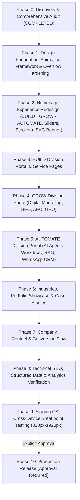

# CodeX404 Solutions — Comprehensive Website Implementation Roadmap

**Project:** CodeX404 Solutions Complete Website Redesign & Modern Motion Experience  
**Canonical Domain:** https://codex404solutions.com/  
**Primary Email:** info@codex404solutions.com  
**Brand Architecture:** BUILD · GROW · AUTOMATE  
**Audit & Implementation Status:** Phase 0 audit complete; Phases 1–8 are implemented in part in the local working tree; local QA in progress; staging and production release are not authorized.  
**Status updated:** 2026-11-19

## Current implementation status

| Phase | Status | Notes |
|---|---|---|
| 0. Discovery and audit | Complete as a source audit | Audit documents are in `docs/Main-Website/`; hosting and production behavior remain external/unverified. |
| 1. Shared foundation | Implemented in part | Shared styling, animation/reveal assets, overflow rules, and responsive navigation are in the working tree. |
| 2. Homepage | Implemented in part | Homepage sections and content were revised; 320px and 375px samples passed visual inspection after narrow-screen CSS safeguards. Full route, breakpoint, and assistive-technology QA remains open. |
| 3. BUILD | Overview implemented | Existing software, SaaS, and mobile routes remain; candidate routes are not created without distinct validated content. |
| 4. GROW | Overview implemented | Existing solutions route remains; additional specialist pages require confirmed delivery scope. |
| 5. AUTOMATE | Overview implemented | Existing AI and automation routes remain; no unsupported demo or integration claims are introduced. |
| 6. Industries and work | Existing routes preserved | Publication permissions and case-study evidence remain to be confirmed. |
| 7. Company and conversion | Implemented in part | Contact routing, consent validation, delivery states, and process-page claims were revised. Production integration behavior and remaining form QA are still open. |
| 8. SEO and analytics | Implemented in part | Sitemap, robots rules, division metadata, and opt-in analytics loading updated. Search Console and production canonical checks remain external. |
| 9. QA and staging | Local QA only | Do not deploy to staging without explicit authorization; production DB and mail delivery are not exercised locally. |
| 10. Production | Not started | Requires explicit user approval after staging review. |

The user has authorized implementation and local verification. This authorization does not override the PRD and RULES release gate for staging/production or permission-sensitive portfolio publication.

---

## 1. Phased Execution Architecture

---

## 2. Phase-by-Phase Plan & Deliverables

### Phase 0: Discovery & Comprehensive Audit (STATUS: COMPLETED ✅)

- [x] Full codebase inspection (PHP 8.2+, MVC architecture, MySQL PDO with JSON fallback).
- [x] Complete route inventory and sitemap mapping.
- [x] Design system and token analysis (`main.css`, `components.css`, `responsive.css`).
- [x] Overflow risk analysis (viewport trapping, SVG scaling, floating widget collisions).
- [x] Application security and threat model verification.
- [x] Public claim and testimonial verification against zero-fantasy rules.
- [x] Deliverables generated:
  - `docs/Main-Website/PROJECT_AUDIT.md`
  - `docs/Main-Website/CURRENT_SITEMAP.md`
  - `docs/Main-Website/EXISTING_ROUTE_INVENTORY.md`
  - `docs/Main-Website/DESIGN_SYSTEM_AUDIT.md`
  - `docs/Main-Website/CONTENT_AUDIT.md`
  - `docs/Main-Website/DATABASE_AUDIT.md`
  - `docs/Main-Website/SEO_AUDIT.md`
  - `docs/Main-Website/SECURITY_AUDIT.md`
  - `docs/Main-Website/CLAIM_VERIFICATION_REGISTER.md`
  - `docs/Main-Website/WEBSITE_IMPLEMENTATION_ROADMAP.md`
  - `docs/Main-Website/ANTIGRAVITY_HANDOFF.md` updated.
- **Exit Gate:** Founder reviews audit report and approves commencement of Phase 1.

---

### Phase 1: Shared Design Foundation, Animation Framework & Overflow Hardening

**Goal:** Establish clean, reusable motion primitives and bulletproof responsive layout rules before modifying page layouts.

**Tasks:**

1. **Repository Safety:** Create and confirm feature branch `feature/codex404-build-grow-automate`.
2. **Animation Engine (`website/assets/css/animations.css`):**
   - Hardware-accelerated keyframe animations: `fade-in-up`, `glow-pulse`, `shimmer-sheen`, `marquee-scroll`, `gradient-flow`, `float-gentle`.
   - Colorful text gradient animation utility (`.gradient-text-animated`).
   - Strict `prefers-reduced-motion: reduce` compliance across all keyframes.
3. **Scroll & Reveal Engine (`website/assets/js/scroll-engine.js`):**
   - High-efficiency `IntersectionObserver` observing elements with `data-reveal` or `.reveal-on-scroll`.
   - Staggered delay sequencing for grid cards.
4. **Nuclear Overflow & Overlap Hardening:**
   - Enforce `html, body { overflow-x: clip; max-width: 100vw; }` across all stylesheets.
   - Constrain all media, canvas, and SVG assets with `max-width: 100%; box-sizing: border-box;`.
   - Prevent z-index collisions between floating action buttons, chatbot, and mobile navigation drawer.
5. **Division Token Mapping:**
   - Formalize division tokens:
     - BUILD: `--color-build: #3B82F6` (Electric Blue)
     - GROW: `--color-grow: #8B5CF6` (Vivid Purple)
     - AUTOMATE: `--color-automate: #10B981` (Emerald Green)
6. **Navigation Enhancement (`website/includes/navigation.php`):**
   - Integrate division cues in the main navigation.
   - Maintain accessible mobile drawer with keyboard focus trap and ARIA expanded states.

- **Exit Gate:** Shared animations, tokens, and overflow prevention verified; no homepage disruption.

---

### Phase 2: Homepage Experience Redesign

**Goal:** Deliver the full-spectrum homepage experience with the approved hero, interactive sliders, scrollers, SVG flow banner, and the three divisions (BUILD · GROW · AUTOMATE).

**Tasks:**

1. **Hero Section:**
   - Preserve approved hero composition, typewriter headline, and interactive terminal.
   - Update supporting copy to clearly state: _We build digital products, grow your online visibility, and automate business operations._
   - Dynamic typewriter rotating across BUILD, GROW, and AUTOMATE capabilities.
2. **Dual-Speed Infinite Tech Marquee:**
   - Dual-row forward and reverse scroller with smooth pause-on-hover and GPU acceleration.
3. **Animated SVG Engineering Flow Banner:**
   - Dynamic interactive SVG flow visualizer (Client Need &rarr; Architecture & AI &rarr; Hardened Build &rarr; Production Asset).
   - Fluid auto-scaling across all device viewports (320px–1920px) with zero horizontal overflow traps.
4. **Three Core Division Cards (BUILD · GROW · AUTOMATE):**
   - High-contrast 3D tilt cards with division accent badges, plain-language outcomes, and links to division portals.
5. **Interactive Horizontal Industry & Use Case Slider:**
   - Touch/drag and auto-scrolling slider highlighting solutions across Healthcare, E-Commerce, School Portals, Real Estate, and Booking.
6. **Verified Deliverables Showcase:**
   - Category filtering (All, Booking, Software, E-Commerce, Mobile, AI) and interactive live demo sandbox modal.
7. **Interactive Simulators:**
   - Enterprise AI RAG simulator and WhatsApp CRM webhook demo.
8. **Efficiency ROI Calculator:**
   - Interactive dual-slider calculating hours and capital recovered through automation.
9. **Founder & Leadership Section:**
   - Authentic engineering leadership cards and direct systems architecture philosophy.
10. **Delivery Process & FAQs:**
    - 4-step deterministic process and accessible FAQ accordion with Schema.org markup.
11. **Responsive Testing:**
    - Test seamlessly at 320px, 375px, 425px, 768px, 1024px, 1440px, and 1920px.

- **Exit Gate:** Homepage approved across mobile, tablet, and desktop viewports.

---

### Phases 3–10: Divisions, Portals, QA & Staging

- **Phase 3:** BUILD Division Portal (`/build/`) & service pages.
- **Phase 4:** GROW Division Portal (`/grow/`) including Digital Marketing, SEO, AEO, GEO.
- **Phase 5:** AUTOMATE Division Portal (`/automate/`) covering AI Agents, Chatbots, Workflows.
- **Phase 6:** Case studies, portfolio and industry portals.
- **Phase 7:** Company, contact, and division-routed inquiry form.
- **Phase 8:** SEO, AEO, GEO, XML sitemap update, and structured data validation.
- **Phase 9:** Staging QA and cross-device verification.
- **Phase 10:** Production release upon explicit user approval.
